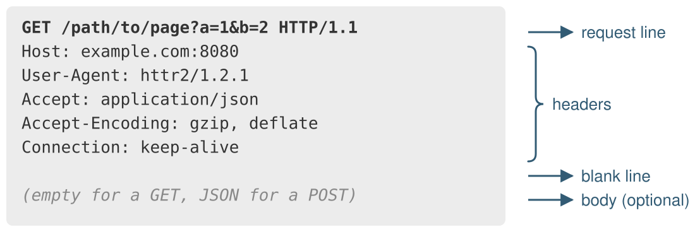
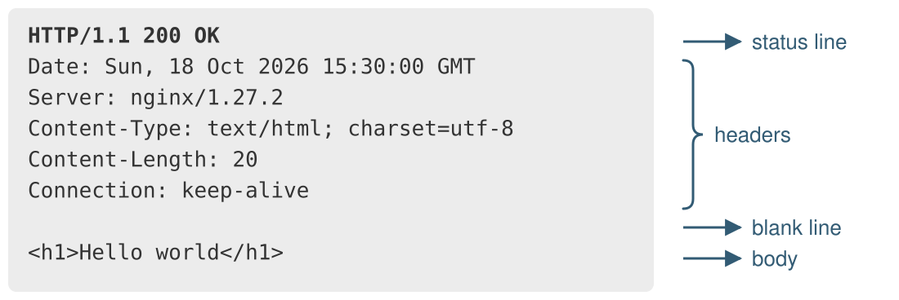

```{r setup}
#| message: false
#| warning: false
#| include: false
options(
  width = 45
)

knitr::opts_chunk$set(
  fig.align = "center", fig.retina = 2, dpi = 150,
  out.width = "100%"
)

library(httr2)
```

```{python py_setup}
#| include: false
import builtins
import pprint
import sys

import requests

def _display(value):
    if value is None:
        return
    builtins._ = value
    if isinstance(value, (list, dict)):
        pprint.pprint(value, width=45, sort_dicts=False)
    else:
        print(repr(value))

sys.displayhook = _display
```


## Reading directly from the web

Most functions that read from a file path will also accept a URL, downloading the file for you behind the scenes.

:::: {.columns .xsmall}
::: {.column width='50%'}
```{python}
import pandas as pd
import urllib.request

url = "https://sta523-fa26.github.io/slides/data/penguins.csv"
```

```{python}
pd.read_csv(url).shape
urllib.request.urlopen(url).readline()
```

```{python}
#| eval: false
urllib.request.urlretrieve(url, "penguins.csv")
```
:::

::: {.column width='50%'}
```{r}
url = "https://sta523-fa26.github.io/slides/data/penguins.csv"
```

```{r}
dim(read.csv(url))
dim(readr::read_csv(url, show_col_types = FALSE))
readLines(url, n = 1)
```

```{r}
#| eval: false
download.file(url, "penguins.csv")
```
:::
::::

This is convenient for a public file at a fixed URL, but there is no way to set headers, authenticate, pass parameters, or handle a failed request. For that we need to work with HTTP directly.


# HTTP

## URLs

{fig-align="center" width="100%"}

::: {.small}
| Component | Description                                                                              |
|:----------|:-----------------------------------------------------------------------------------------|
| scheme    | The protocol to use, usually `http` or `https`                                           |
| host      | The domain name or IP address of the server                                              |
| port      | The port to use, defaults to 80 for `http`, 443 for `https`                              |
| path      | Identifies the resource on the server                                                    |
| query     | Optional key-value pairs                                                                 |
| fragment  | A location within the page, not sent to the server                                       |
:::


## URL encoding

Only a limited set of characters may appear in a URL, so spaces and reserved characters like `&`, `/`, and `?` are *percent encoded*. These values are usually not part of the host or path but can occur as part of the query string.

::: {.xsmall}
```{python}
from urllib.parse import urlencode, quote, unquote
```
:::

:::: {.columns .xsmall}
::: {.column width='50%'}
```{python}
urlencode({"q": "hello world", "n": 10})
quote("a/b?c=d&e", safe="")
unquote("hello%20world")
```
:::

::: {.column width='50%'}
```{r}
URLencode("hello world")
URLencode("a/b?c=d&e", reserved = TRUE)
URLdecode("hello%20world")
```
:::
::::

Implementations can be inconsistent (e.g. spaces can be encoded as `+` or `%20`) but consumers are generally permissive. Both `requests` and `httr2` encode parameter values automatically.


## HTTP requests

An HTTP request is made up of a method, a URL, headers, and an optional body.

<br/>

{fig-align="center" width="100%"}


## HTTP methods

The method, or verb, says what we want done with the resource at the URL.

| Method   | Purpose                      | GitHub API example              |
|:---------|:-----------------------------|:--------------------------------|
| `GET`    | Fetch a resource             | Get a user, list org repos      |
| `POST`   | Create a new resource        | Create a gist, open an issue    |
| `PUT`    | Replace a resource           | Replace a file in a repo        |
| `PATCH`  | Partially update a resource  | Update a repo's description     |
| `DELETE` | Remove a resource            | Delete a gist                   |

<br/>

`GET` and `POST` are by far the most common when consuming APIs.

Loading a page in a browser is a `GET`, and submitting a form is usually a `POST`.


## HTTP responses

An HTTP response contains a status, headers, and an optional body (HTML, JSON, an image, or other content).

<br/>

{fig-align="center" width="100%"}


## Status codes

The first digit gives the category. `1xx` is informational, `2xx` is success, `3xx` concerns redirection or caching, `4xx` a problem with the request, and `5xx` a problem on the server.

::: {.small}
| Code | Description              | Meaning                                         |
|:----:|:-------------------------|:------------------------------------------------|
| 200  | OK                       | Request succeeded                               |
| 201  | Created                  | Resource created, usually after a `POST`        |
| 204  | No Content               | Success with no response body                   |
| 301  | Moved Permanently        | Permanent redirect                              |
| 400  | Bad Request              | Malformed request or parameters                 |
| 401  | Unauthorized             | Authentication required or failed               |
| 403  | Forbidden                | Server refuses access, may also mean rate limited |
| 404  | Not Found                | Resource not found or not visible to this client  |
| 429  | Too Many Requests        | Rate limit exceeded                             |
| 500  | Internal Server Error    | Server-side failure                             |
| 503  | Service Unavailable      | Server temporarily unavailable                  |
:::

The code is only a summary. For an error, the response body will usually include a more specific message explaining what went wrong, so it is worth reading.


## `requests`

:::: {.columns}
::: {.column width='62%'}
`requests` is the standard third-party Python package for HTTP. A call such as `requests.get()` builds and sends a request in one step and returns a response object. Its attributes and methods give the status, headers, and parsed body.

::: {.small}
```{python}
#| eval: false
requests.get(
  url, params=..., headers=..., timeout=10
)
requests.post(url, json=...)
```
:::
:::

::: {.column width='38%'}
{fig-align="center" width="60%"}
:::
::::

::: {.aside}
[requests.readthedocs.io](https://requests.readthedocs.io/)
:::


## `httr2`

:::: {.columns}
::: {.column width='62%'}
`httr2` separates building a request from performing it. A request object is built up with `req_*()` functions, sent with `req_perform()`, and the resulting response is inspected with `resp_*()` functions.

::: {.small}
```{r}
#| eval: false
request(url) |>
  req_url_query(...) |>
  req_headers(...) |>
  req_timeout(10) |>
  req_perform()
```
:::
:::

::: {.column width='38%'}
{fig-align="center" width="70%"}
:::
::::

::: {.aside}
[`httr2`](https://httr2.r-lib.org/) is a rewrite of the older `httr` package with a pipeable API.
:::


# REST APIs

## REST

Representational State Transfer is an architectural style for web services, not a standard. A RESTful API exposes resources at URLs, called endpoints, and clients work with them using ordinary HTTP.

* Resources are addressable. Every resource has its own URL, such as `/users/rundel` or `/orgs/tidyverse/repos`.

* Requests are stateless. Each request carries everything the server needs to handle it, so nothing is remembered between requests.

* The interface is uniform. The standard HTTP methods say what to do and the status codes say how it went.

* Resources are returned as representations in the response body. JSON is the most common format, but REST does not require it.

Last lecture we scraped data out of HTML meant for people. APIs provide structured data meant for programs.


## GitHub API

GitHub's REST API exposes nearly everything on the site. We will use it as a running example because it is well documented, mostly public, and the responses are plain JSON.

::: {.center .large}
[GitHub REST API](https://docs.github.com/en/rest)
:::

<br/>

Endpoints used today,

::: {.medium}
* [Get a user](https://docs.github.com/en/rest/users/users#get-a-user), `GET /users/{username}`

* [List organization repositories](https://docs.github.com/en/rest/repos/repos#list-organization-repositories), `GET /orgs/{org}/repos`

* [Get the authenticated user](https://docs.github.com/en/rest/users/users#get-the-authenticated-user), `GET /user`

* [Create a gist](https://docs.github.com/en/rest/gists/gists#create-a-gist), `POST /gists`
:::


## A first request

:::: {.columns .xsmall}
::: {.column width='50%'}
```{python}
api = "https://api.github.com"
resp = requests.get(
  api + "/users/rundel", timeout=10
)
resp
resp.raise_for_status()
```
:::

::: {.column width='50%'}
```{r}
#| cache: true
api = "https://api.github.com"
resp = request(api) |>
  req_url_path_append("users", "rundel") |>
  req_timeout(10) |>
  req_perform()
resp
```
:::
::::

:::: {.columns .xsmall}
::: {.column width='50%'}
```{python}
resp.status_code
resp.json()["name"]
```
:::

::: {.column width='50%'}
```{r}
resp_status(resp)
resp_body_json(resp)$name
```
:::
::::

Sending the request returns a response. Calling `.json()` or `resp_body_json()` then parses its body. Successful JSON parsing alone does not mean the request succeeded.


## A failed request {.wrap-output}

:::: {.columns .xsmall}
::: {.column width='50%'}
```{python}
#| error: true
resp = requests.get(
  api + "/users/not-a-real-user-xyz", timeout=10
)
resp.raise_for_status()
```
:::

::: {.column width='50%'}
```{r bad-request}
#| cache: true
#| error: true
request(api) |>
  req_url_path_append("users", "not-a-real-user-xyz") |>
  req_timeout(10) |>
  req_perform()
```
:::
::::

:::: {.columns .xsmall}
::: {.column width='50%'}
```{python}
resp.status_code
resp.json()["message"]
```
:::

::: {.column width='50%'}
```{r}
#| cache: true
#| dependson: "bad-request"
resp = last_response()
resp_status(resp)
resp_body_json(resp)$message
```
:::
::::

GitHub still sends a response, with a `404` status and a JSON body describing the problem. `httr2` raises an error as soon as it arrives and `requests` only raises if you call `raise_for_status()`, but in both cases the response can still be inspected.

## Building a request {.wrap-output}

A request can be inspected before anything is sent, which is useful for checking that the URL and headers are what we intended.

:::: {.columns .xsmall}
::: {.column width='50%'}
```{python}
org_url = api + "/orgs/tidyverse/repos"
req = requests.Request(
  "GET", org_url,
  params={"per_page": 100},
  headers={"User-Agent": "Sta523 demo client"}
).prepare()
```
:::

::: {.column width='50%'}
```{r}
req = request(api) |>
  req_url_path_append("orgs/tidyverse/repos") |>
  req_url_query(per_page = 100) |>
  req_user_agent("Sta523 demo client")
```
:::
::::

:::: {.columns .xsmall}
::: {.column width='50%'}
```{python}
req.url
req.headers
```
:::

::: {.column width='50%'}
```{r}
req |> req_dry_run()
```
:::
::::

::: {.aside}
`requests.Request` is rarely needed in practice. Passing the same arguments to `requests.get()` builds and sends the request in one step.
:::


## Query parameters {.wrap-output}

Parameters are given as a dictionary in Python or as named arguments in R. The libraries add them to the URL and handle the encoding.

:::: {.columns .xsmall}
::: {.column width='50%'}
```{python}
resp = requests.get(
  org_url,
  params={"per_page": 5, "sort": "updated"},
  timeout=10
)
resp.raise_for_status()
```
:::

::: {.column width='50%'}
```{r}
#| cache: true
resp = request(api) |>
  req_url_path_append("orgs/tidyverse/repos") |>
  req_url_query(
    per_page = 5, sort = "updated"
  ) |>
  req_timeout(10) |>
  req_perform()
```
:::
::::

:::: {.columns .xsmall}
::: {.column width='50%'}
```{python}
resp.url
[repo["full_name"] for repo in resp.json()]
```
:::

::: {.column width='50%'}
```{r}
resp$url
resp_body_json(resp) |>
  purrr::map_chr("full_name")
```
:::
::::


## Response objects

::: {.small}
| Content            | `requests`                        | `httr2`                                    |
|:-------------------|:----------------------------------|:-------------------------------------------|
| status code        | `resp.status_code`, `resp.ok`           | `resp_status()`, `resp_is_error()`         |
| status text        | `resp.reason`                        | `resp_status_desc()`                       |
| content type       | `resp.headers.get("Content-Type")`       | `resp_content_type()`                      |
| all headers        | `resp.headers`                       | `resp_headers()`                           |
| one header         | `resp.headers["X-RateLimit-Limit"]`  | `resp_header("X-RateLimit-Limit")`         |
| final URL          | `resp.url`                           | `resp$url`                                 |
:::

::: {.aside}
Python's `resp.ok` means status < 400, including redirects, not exactly `200 OK`. Optional headers can be absent, so use `.get()` when appropriate.
:::


## Inspecting a response

:::: {.columns .xsmall}
::: {.column width='50%'}
```{python}
resp = requests.get(
  api + "/users/rundel", timeout=10
)
```
:::

::: {.column width='50%'}
```{r}
#| cache: true
resp = request(api) |>
  req_url_path_append("users", "rundel") |>
  req_timeout(10) |>
  req_perform()
```
:::
::::

:::: {.columns .xsmall}
::: {.column width='50%'}
```{python}
resp.status_code, resp.reason
```
:::

::: {.column width='50%'}
```{r}
#| cache: true
resp_status(resp)
resp_status_desc(resp)
```
:::
::::

:::: {.columns .xsmall}
::: {.column width='50%'}
```{python}
resp.headers["Content-Type"]
resp.headers["X-RateLimit-Remaining"]
```
:::

::: {.column width='50%'}
```{r}
resp_content_type(resp)
resp |> resp_header("X-RateLimit-Remaining")
```
:::
::::

Headers carry metadata about the response.

::: {.aside}
Here GitHub tells us how many unauthenticated requests we have left this hour.
:::

## Parsing the body

JSON objects become dictionaries in Python and named lists in R.

:::: {.columns .xsmall}
::: {.column width='50%'}
```{python}
resp.raise_for_status()
user = resp.json()
type(user)
```
:::

::: {.column width='50%'}
```{r}
user = resp_body_json(resp)
class(user)
```
:::
::::

:::: {.columns .xsmall}
::: {.column width='50%'}
```{python}
fields = ["login", "name", "public_repos"]
{k: user[k] for k in fields}
```
:::

::: {.column width='50%'}
```{r}
fields = c("login", "name", "public_repos")
user[fields] |> str()
```
:::
::::

::: {.aside}
`resp_body_json()` uses `jsonlite` with `simplifyVector = FALSE`, so arrays stay as lists.
:::


## Other body types

JSON is the most common response from an API, but the body can be anything. Both libraries expose the raw bytes and the decoded text, and provide parsers for the usual formats.

::: {.small}
| Content        | `requests`                               | `httr2`                                   |
|:---------------|:-----------------------------------------|:------------------------------------------|
| JSON           | `resp.json()`                            | `resp_body_json(resp)`                    |
| Text           | `resp.text`                              | `resp_body_string(resp)`                  |
| Raw bytes      | `resp.content`                           | `resp_body_raw(resp)`                     |
| HTML           | `BeautifulSoup(resp.text, "html.parser")`| `resp_body_html(resp)`                    |
| XML            | `xml.etree.ElementTree.fromstring(resp.content)` | `resp_body_xml(resp)`             |
| CSV            | `pd.read_csv(io.StringIO(resp.text))`    | `read.csv(text = resp_body_string(resp))` |
| Save to a file | `open(path, "wb").write(resp.content)`   | `req_perform(req, path = path)`           |
:::

::: {.aside}
The `Content-Type` header, available via `resp.headers["Content-Type"]` or `resp_content_type(resp)`, says what the server actually sent.
:::


## Error handling {#error-handling .wrap-output}

The libraries disagree on the default. `httr2` turns a `4xx` or `5xx` status into an R error, while `requests` returns the response and leaves checking to you.

:::: {.columns .xsmall}
::: {.column width='50%'}
```{python}
resp = requests.get(api + "/user", timeout=10)
resp.status_code, resp.ok
resp.json()["message"]
```
:::

::: {.column width='50%'}
```{r}
#| cache: true
#| error: true
request(api) |>
  req_url_path_append("user") |>
  req_timeout(10) |>
  req_perform()
```
:::
::::

:::: {.columns .xsmall}
::: {.column width='50%'}
```{python}
#| error: true
resp.raise_for_status()
```
:::

::: {.column width='50%'}
```{r}
#| cache: true
resp = request(api) |>
  req_url_path_append("user") |>
  req_error(is_error = \(resp) FALSE) |>
  req_timeout(10) |>
  req_perform()
resp_status(resp)
resp_body_json(resp)$message
```
:::
::::

::: {.aside}
`req_error()` can also take a `body` function that extracts the server's error message to include in the R error.
:::


## Pagination

Most APIs cap the number of results in one response, so retrieving a large collection means a sequence of requests. There is no single convention, so check the documentation for each API.

* Page-based, `?page=2&per_page=30`

* Offset-based, `?offset=60&limit=30`

* Cursor-based, each response includes a token that identifies the next batch

* Link header, the response's `Link` header gives the URL of the next page

GitHub uses page-based parameters and also returns a `Link` header, so a client can follow the `next` link until there is none.


## GitHub pagination {.wrap-output}

:::: {.columns .xsmall}
::: {.column width='50%'}
```{python}
resp = requests.get(
  org_url,
  params={"per_page": 25}, timeout=10
)
resp.raise_for_status()
len(resp.json())
```
:::

::: {.column width='50%'}
```{r}
#| cache: true
resp = request(api) |>
  req_url_path_append("orgs/tidyverse/repos") |>
  req_url_query(per_page = 25) |>
  req_timeout(10) |>
  req_perform()
length(resp_body_json(resp))
```
:::
::::

:::: {.columns .xsmall}
::: {.column width='50%'}
```{python}
resp.links
```
:::

::: {.column width='50%'}
```{r}
resp_link_url(resp, "next")
resp_link_url(resp, "last")
```
:::
::::

`requests` parses the `Link` header into the `links` dictionary, and `httr2` provides `resp_link_url()` to pull out a single relation.


## Following links

Collect a page, follow its `next` link, and stop when that link is absent. `httr2` provides an iterator for this pattern.

:::: {.columns .xsmall}
::: {.column width='50%'}
```{python}
url = org_url
params = {"per_page": 25}
repos = []

while url is not None:
    resp = requests.get(
        url, params=params, timeout=10
    )
    resp.raise_for_status()
    repos.extend(resp.json())
    next_link = resp.links.get("next", {})
    url = next_link.get("url")
    params = None
```
:::

::: {.column width='50%'}
```{r}
#| cache: true
resps = request(api) |>
  req_url_path_append("orgs/tidyverse/repos") |>
  req_url_query(per_page = 25) |>
  req_timeout(10) |>
  req_perform_iterative(
    next_req = iterate_with_link_url(),
    max_reqs = Inf, progress = FALSE
  )

repos = resps |>
  resps_data(resp_body_json)
```
:::
::::

::: {.aside}
The next URL includes its query parameters, so Python resets `params` after the first request. `max_reqs = Inf` removes R's default cap of 20 requests.
:::


## Checking the combined results {.scrollable}

:::: {.columns .xsmall}
::: {.column width='50%'}
```{python}
len(repos)
[repo["full_name"] for repo in repos]
```
:::

::: {.column width='50%'}
```{r}
length(repos)
repos |>
  purrr::map_chr("full_name")
```
:::
::::


## Authentication and rate limits

Everything so far has been anonymous. Most APIs give anonymous clients a small rate limit and no access to private resources, and require authentication for anything more.

::: {.medium .pt-2}
| GitHub API      | Requests per hour | Access                       |
|:----------------|------------------:|:-----------------------------|
| Unauthenticated | 60                | Public data only             |
| Authenticated   | Usually 5,000     | Resources allowed by the token |
:::

GitHub accepts a bearer token in the `Authorization` header, sent as `Authorization: Bearer <token>`. Other APIs may use API keys, OAuth, or another scheme.

The token identifies you to the API and grants its assigned permissions. Treat it like a password. [GitHub rate limits](https://docs.github.com/en/rest/using-the-rest-api/rate-limits-for-the-rest-api) vary by authentication method, and secondary limits also apply.


## Personal access tokens

A personal access token (PAT) is a credential generated on GitHub under Settings > Developer settings > Personal access tokens. Fine-grained tokens scoped to specific repositories and permissions are recommended over classic tokens.

::: {.medium}
* Never put a token in a script, a notebook, or a git repository.

* Store it outside the code and read it at run time, from an environment variable, a file such as `.env` that is ignored by git, or a credential manager.

* Give it the minimum permissions needed and an expiration date.
:::

:::: {.columns .xsmall}
::: {.column width='50%'}
```{python}
#| eval: false
import os
token = os.environ["GITHUB_TOKEN"]
```
:::

::: {.column width='50%'}
```{r}
#| eval: false
gitcreds::gitcreds_set()
token = gitcreds::gitcreds_get()$password
```
:::
::::

```{r}
#| include: false
token = gitcreds::gitcreds_get()$password
```

```{python}
#| include: false
token = r.token
```

::: {.aside}
In R, `gitcreds` stores the token in the operating system's credential store (the same one git uses), so `gitcreds_set()` only needs to be run once per machine. In Python, set the environment variable before running these examples. Never print a token or include it in rendered output.
:::


## Authenticated requests

With the token in place, the `/user` endpoint that [failed earlier](#error-handling) now returns the account the token belongs to.

:::: {.columns .xsmall}
::: {.column width='50%'}
```{python}
resp = requests.get(
  api + "/user",
  headers={
    "Authorization": f"Bearer {token}"
  },
  timeout=10
)
resp.raise_for_status()
```
:::

::: {.column width='50%'}
```{r}
resp = request(api) |>
  req_url_path_append("user") |>
  req_auth_bearer_token(token) |>
  req_timeout(10) |>
  req_perform()
```
:::
::::

:::: {.columns .xsmall}
::: {.column width='50%'}
```{python}
resp.status_code
resp.json()["login"]
resp.headers["X-RateLimit-Limit"]
```
:::

::: {.column width='50%'}
```{r}
resp_status(resp)
resp_body_json(resp)$login
resp_header(resp, "X-RateLimit-Limit")
```
:::
::::


::: {.aside}
`req_auth_bearer_token()` is a convenience for `req_headers(Authorization = paste("Bearer", token))`. Either library accepts the raw header as well.
:::


## Sessions and templates

When making many requests to the same API, set the shared pieces such as the user agent and token once. In `requests` a `Session` carries headers across calls and reuses the connection. In `httr2` a request object is a template that can be extended before each `req_perform()`.

:::: {.columns .xsmall}
::: {.column width='50%'}
```{python}
s = requests.Session()
s.headers.update({
  "User-Agent": "Sta523 demo client",
  "Authorization": f"Bearer {token}"
})
```
:::

::: {.column width='50%'}
```{r}
gh = request(api) |>
  req_user_agent("Sta523 demo client") |>
  req_auth_bearer_token(token) |>
  req_timeout(10)
```
:::
::::

:::: {.columns .xsmall}
::: {.column width='50%'}
```{python}
for login in ["hadley", "wesm"]:
    resp = s.get(
        f"{api}/users/{login}", timeout=10
    )
    resp.raise_for_status()
    print(resp.json()["name"])
```
:::

::: {.column width='50%'}
```{r}
#| cache: true
for (login in c("hadley", "wesm")) {
  user = gh |>
    req_url_path_append("users", login) |>
    req_perform() |> resp_body_json()
  print(user$name)
}
```
:::
::::


::: {.aside}
Close a Python session with `s.close()` when finished.
:::


## Sending data

Both libraries serialize a dictionary or list as JSON and set the appropriate `Content-Type`. This example needs a token with permission to write gists (the Gists account permission on a fine-grained token, or the `gist` scope on a classic one), and creates a public gist on the account the token belongs to.

:::: {.columns .xsmall}
::: {.column width='50%'}
```{python}
gist = {
  "description": "Sta 523 demo",
  "files": {"hello.py": {
    "content": "print('hello world')\n"
  }},
  "public": True
}
resp = s.post(
  api + "/gists", json=gist, timeout=10
)
resp.raise_for_status()
```
:::

::: {.column width='50%'}
```{r}
gist = list(
  description = "Sta 523 demo",
  files = list("hello.R" = list(
    content = "print('hello world')\n"
  )),
  public = TRUE
)
resp = gh |>
  req_url_path_append("gists") |>
  req_body_json(gist) |> req_perform()
```
:::
::::

::: {.aside}
Adding a body switches `httr2` to `POST`. Use `req_method()` to choose `PUT` or `PATCH`.
:::


## Checking a write

Creating a gist returns `201 Created`. Its response body describes the new resource, including its URL and `id`.

:::: {.columns .xsmall}
::: {.column width='50%'}
```{python}
resp.status_code
resp.reason
resp.json()["html_url"]
```
:::

::: {.column width='50%'}
```{r}
resp_status(resp)
resp_status_desc(resp)
resp_body_json(resp)$html_url
```
:::
::::

A successful write can return a different status and body from a successful read, so check the endpoint documentation.


## Cleaning up

A `DELETE` request to `/gists/{gist_id}`, using the `id` returned when the gist was created, removes it. The response has status `204 No Content` and an empty body.

:::: {.columns .xsmall}
::: {.column width='50%'}
```{python}
gist_id = resp.json()["id"]
resp = s.delete(
  f"{api}/gists/{gist_id}", timeout=10
)
resp.raise_for_status()
```
:::

::: {.column width='50%'}
```{r}
gist_id = resp_body_json(resp)$id
resp = gh |>
  req_url_path_append("gists", gist_id) |>
  req_method("DELETE") |>
  req_perform()
```
:::
::::

:::: {.columns .xsmall}
::: {.column width='50%'}
```{python}
resp.status_code
resp.reason
```
:::

::: {.column width='50%'}
```{r}
resp_status(resp)
resp_status_desc(resp)
```
:::
::::


## Rate limiting

A rate limit usually produces a `429`, but some APIs use other `4xx` codes (GitHub sometimes returns a `403`). Check the headers and message before retrying.

:::: {.columns .xsmall}
::: {.column width='50%'}
```{python}
import time

users = ["hadley", "wesm", "rundel"]
for user in users:
    try:
        resp = s.get(
            f"{api}/users/{user}", timeout=10
        )
        resp.raise_for_status()
    finally:
        time.sleep(1)
```
:::

::: {.column width='50%'}
```{r}
gh = gh |>
  req_throttle(
    capacity = 1, fill_time_s = 1
  )

users = c("hadley", "wesm", "rundel")
for (user in users) {
  gh |> req_url_path_append("users", user) |>
    req_perform()
}
```
:::
::::

Both permit one request immediately, then one per second. A capacity of 60 would permit a burst of 60 requests. Choose a rate that fits the API.


## Retries

Transient failures of read requests (a timeout, a `503`, a rate limit) are worth retrying after a pause, with the pause growing on each attempt.

`httr2` builds this in with `req_retry()`. The template below allows up to five attempts, waits with exponential backoff, and honors `Retry-After`.

::: {.xsmall}
```{r}
gh = gh |>
  req_retry(
    max_tries = 5, retry_on_failure = TRUE,
    is_transient = \(resp) resp_status(resp) %in% c(429, 500, 502, 503, 504)
  )
```
:::

`requests` has no retry option of its own. Retries are configured on the underlying `urllib3` connection pool by mounting an `HTTPAdapter` with a `Retry` object on a `Session`, which sets the number of attempts, the backoff, and the statuses and methods that qualify. See [transport adapters](https://requests.readthedocs.io/en/latest/user/advanced/#transport-adapters) and [`urllib3.util.Retry`](https://urllib3.readthedocs.io/en/stable/reference/urllib3.util.html#urllib3.util.Retry).

::: {.aside}
`httr2` does not restrict retries by method, so use this template for reads only. Retrying a write may duplicate it. A GitHub `403` needs a separate rate-limit check.
:::


## Exercise 1

Using the GitHub API, retrieve every public repository belonging to the `posit-dev` organization and build a data frame with one row per repository containing its name, primary language, star count, and the date it was last pushed to.

* Request `type=public` and `per_page=100`, and follow every next-page link. How many repositories and pages are there?

* Tabulate the primary language. Treat a missing language as its own category.

* Which five repositories were pushed to most recently?

Write a version in Python with `requests` and a version in R with `httr2`. Authenticate your requests if you have a token available.


# Summary {visibility="uncounted"}

## `requests` and `httr2` {visibility="uncounted"}

::: {.small}
| Task                   | `requests`                                        | `httr2`                                            |
|:-----------------------|:--------------------------------------------------|:---------------------------------------------------|
| GET                    | `requests.get(url)`                               | `request(url)` then `req_perform()`                   |
| timeout                | `timeout=10`                                      | `req_timeout(10)`                                  |
| query parameters       | `params={...}`                                    | `req_url_query(...)`                               |
| headers                | `headers={...}`                                   | `req_headers(...)`                                 |
| bearer token           | `headers={"Authorization": f"Bearer {t}"}`        | `req_auth_bearer_token(t)`                         |
| send JSON              | `requests.post(url, json=...)`                    | `req_body_json(...)`                               |
| other methods          | `requests.put()`, `.patch()`, `.delete()`         | `req_method()`                                     |
| inspect before sending | `requests.Request(...).prepare()`                 | `req_dry_run()`                                    |
| status                 | `resp.status_code`, `resp.ok`                           | `resp_status()`, `resp_is_error()`                 |
| raise on error         | `resp.raise_for_status()`                            | default, disable with `req_error()`                |
| parse JSON             | `resp.json()`                                        | `resp_body_json()`                                 |
| headers                | `resp.headers`                                       | `resp_headers()`, `resp_header()`                  |
| pagination             | `resp.links["next"]["url"]` in a loop                | `req_perform_iterative()`, `resps_data()`          |
| shared settings        | `requests.Session()`                              | a request object used as a template                |
| throttle / retry       | `time.sleep()`, `urllib3.util.Retry`              | `req_throttle()`, `req_retry()`                    |
:::


## Takeaways {visibility="uncounted"}

::: {.medium}
* HTTP is a request with a method, URL, headers, and body, answered by a response with a status, headers, and body. Everything on the web, including scraping and APIs, is built on this exchange.

* A REST API exposes resources at URLs using HTTP methods and representations such as JSON. The status code says whether it worked and the JSON body carries the result.

* `requests` does each request in a single function call, while `httr2` builds a request object and then performs it. Both give back a response object with the status, headers, and methods for parsing the body.

* Check the status. `httr2` errors by default and `requests` does not, so call `raise_for_status()` before parsing. Set a timeout as well.

* Large collections come back a page at a time. Follow the `Link` header or page parameters until the results run out.

* Authenticate with a token kept out of your code, respect rate limits, and be careful with any request that is not a `GET`.
:::
