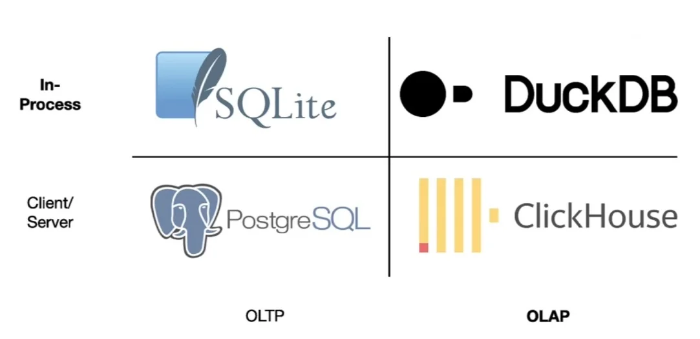

# DuckDB

```{r setup}
#| message: false
#| warning: false
#| include: false
library(dplyr)
library(duckknit)

options(
  duckdb.home = "~/.duckdb",
  width = 80,
  pillar.print_max = 6,
  pillar.print_min = 6
)

knitr::opts_chunk$set(
  fig.align = "center", fig.retina = 2, dpi = 150,
  out.width = "100%"
)

# duckknit chunks are labelled as SQL so they are highlighted, styled, and copyable
knitr::opts_hooks$set(engine = function(options) {
  if (options$engine == "duckdb") {
    options$lang = "sql"
    options$class.source = "duckdb-cli"
    options$prompt = TRUE
  }
  options
})

if (!file.exists("data/flights.parquet")) {
  nanoparquet::write_parquet(nycflights13::flights, "data/flights.parquet")
}
if (!file.exists("data/planes.parquet")) {
  nanoparquet::write_parquet(nycflights13::planes, "data/planes.parquet")
}

unlink(c(
  "data/employees.duckdb", "data/employees.duckdb.wal",
  "data/flights.duckdb", "data/flights.duckdb.wal"
))

if (!dir.exists("data/flights")) {
  dir.create("data/flights")
  con = DBI::dbConnect(duckdb::duckdb())
  for (m in 1:12) {
    file = paste0("data/flights/2013-", formatC(m, width = 2, flag = "0"), ".parquet")
    DBI::dbExecute(con, paste0(
      "COPY (SELECT * FROM 'data/flights.parquet' WHERE month = ", m, ") TO '", file, "'"
    ))
  }
  DBI::dbDisconnect(con, shutdown = TRUE)
}
if (!file.exists("data/train_services.parquet")) {
  download.file("https://blobs.duckdb.org/train_services.parquet", "data/train_services.parquet", mode = "wb")
}

employees = tibble(
  name   = c("Alice", "Bob", "Carol", "Dave", "Eve", "Frank"),
  salary = c(52000, 40000, 30000, 33000, 44000, 37000),
  dept   = c("Accounting", "Accounting", "Sales", "Accounting", "Sales", "Sales")
)

con = DBI::dbConnect(duckdb::duckdb("data/employees.duckdb"))
DBI::dbWriteTable(con, "employees", employees)
DBI::dbDisconnect(con, shutdown = TRUE)

con = DBI::dbConnect(duckdb::duckdb("data/flights.duckdb"))
DBI::dbExecute(con, "CREATE TABLE flights AS SELECT * FROM 'data/flights.parquet'")
DBI::dbExecute(con, "CREATE TABLE planes AS SELECT * FROM 'data/planes.parquet'")
DBI::dbDisconnect(con, shutdown = TRUE)
```

```{css}
/*| echo: false
.reveal pre code {
  text-wrap-mode: nowrap !important;
  max-height: 520px !important;
}
```


## DuckDB

DuckDB is an open source, in-process, analytical relational database. It was created at CWI in the Netherlands and first released in 2019.

* In-process means there is no server. The engine is a library that runs inside R, Python, or the CLI, and a database is a single file.

* Analytical means online analytical processing (OLAP) vs online transaction processing (OLTP).

* Data is stored by column.

* CSV, JSON, and Parquet files can be queried directly without an explicit import step.

::: {.aside}
See [duckdb.org](https://duckdb.org/) and [Why DuckDB](https://duckdb.org/why_duckdb).
:::


## OLTP vs OLAP, in-process vs server

::: {.center}

:::

::: {.aside}
From InfoQ - [In-Process Analytical Data Management with DuckDB](https://www.infoq.com/articles/analytical-data-management-duckdb/)
:::


## Where we left off

Last time we used DuckDB as the engine behind `DBI` and `dbplyr` in R and the DB-API in Python.

:::: {.columns .xsmall}
::: {.column width='50%'}
```{r}
con = DBI::dbConnect(duckdb::duckdb())
DBI::dbGetQuery(con, "SELECT 42 AS answer")
DBI::dbDisconnect(con, shutdown = TRUE)
```
:::

::: {.column width='50%'}
```{python}
import duckdb
duckdb.sql("SELECT 42 AS answer")
```
:::
::::

Today the focus is the SQL itself, using DuckDB's command line interface (CLI). Everything we use today works in the same way when run through `dbGetQuery()` or `duckdb.sql()`.


# The DuckDB CLI

## Installing

The CLI is a single executable with no dependencies. It is separate from the R and Python packages, which bundle the engine but not the shell.

::: {.small .pt-2}
```bash
# macOS
brew install duckdb
```
:::

::: {.small .pt-2}
```bash
# Linux / macOS
curl https://install.duckdb.org | sh
```
:::

::: {.small .pt-2}
```bash
# Windows
winget install DuckDB.cli
```
:::

The CLI is already installed on the department servers.


::: {.aside}
See [installation](https://duckdb.org/docs/installation/) for all platforms and the [CLI overview](https://duckdb.org/docs/stable/clients/cli/overview).
:::


## Connecting

Just like with `DBI`, running `duckdb` with a file path opens (or creates) that database. With no path the database is initialized in memory and discarded on exit.

::: {.small}
```{.bash .shell}
duckdb data/employees.duckdb
```
```
DuckDB v2.0.0 (Cyanoptera) d54cbbe3df
Enter ".help" for usage hints.
employees D
```
:::

. . .

Once connected you type SQL statements, ending each with a semicolon.

::: {.small}
```{duckdb, db='data/employees.duckdb', session='employees'}
SELECT 'Hello, DuckDB!' AS greeting;
```
:::

::: {.aside}
The SQL in this deck is run through the CLI when the slides are built (via the `duckknit` package). The `D` prompt is decoration and is not copied with the code.
:::


## Dot commands

Commands beginning with `.` are instructions to the shell rather than SQL. They do not need a semicolon.

:::: {.columns .xsmall}
::: {.column width='40%'}
```{duckdb}
.tables
```
:::

::: {.column width='60%' .fragment}
```{duckdb}
.schema employees
```
```{duckdb}
.version
```
:::
::::

::: {.aside}
`.help` lists all of the dot commands. See also the [dot command docs](https://duckdb.org/docs/stable/clients/cli/dot_commands.html).
:::


## A first query

::: {.small}
```{duckdb}
SELECT * FROM employees;
```
:::

SQL keywords are case insensitive. By convention they are written in upper case and identifiers in lower case. Whitespace and line breaks are ignored, and a statement ends with a semicolon.


## Output formats

The default output format is called `duckbox`. The format can be changed via `.mode`.

:::: {.columns .mxsmall}
::: {.column width='50%'}
```{duckdb}
.mode csv
SELECT name, dept FROM employees LIMIT 3;
```
:::

::: {.column width='50%'}
```{duckdb}
.mode markdown
SELECT name, dept FROM employees LIMIT 3;
```
:::
::::

:::: {.columns .mxsmall}
::: {.column width='50%'}
```{duckdb}
.mode json
SELECT name, dept FROM employees LIMIT 3;
```
:::

::: {.column width='50%'}
```{duckdb}
.mode line
SELECT name, dept FROM employees LIMIT 3;
```
:::
::::

```{duckdb}
#| include: false
.mode duckbox
```

::: {.aside}
See [output formats](https://duckdb.org/docs/stable/clients/cli/output_formats.html) for the full list. `.mode` is persistent for your session.
:::


# Files as tables

## Files as tables

DuckDB can treat a CSV (or Parquet or JSON) file as a table, so a file can be queried without importing it.

:::: {.columns .xsmall}
::: {.column width='50%'}
```{duckdb}
SELECT * FROM 'data/phone.csv';
```
:::

::: {.column width='50%' .fragment}
```{duckdb}
SELECT * FROM
  read_csv('data/phone.csv', delim = ',');
```
:::
::::

Quoting the filename is equivalent to calling `read_csv()`. The function form is needed when the file requires options, e.g. a different delimiter or explicit column types.

::: {.aside}
Column types are inferred by sampling the file, see [CSV loading](https://duckdb.org/docs/stable/data/csv/overview).
:::


## Tables from files

A table can be created from any query with `CREATE TABLE ... AS`, including a query on a file.

:::: {.columns .small}
::: {.column width='50%'}
```{duckdb}
CREATE TABLE phone AS
  SELECT * FROM 'data/phone.csv';
```
```{duckdb}
SHOW TABLES;
```
:::

::: {.column width='50%' .fragment}
```{duckdb}
SELECT * FROM phone;
```
:::
::::

The data is copied into the database, so the file is no longer needed.

::: {.aside}
`SHOW TABLES` is the SQL equivalent of `.tables`, so it also works from R and Python.
:::


## Views

A view stores the query rather than its result. It can be used like a table but is re-evaluated each time, so the file is read on every query and must remain available.

:::: {.columns .small}
::: {.column width='50%'}
```{duckdb}
CREATE VIEW phone_view AS
  SELECT * FROM 'data/phone.csv';
```
```{duckdb}
SHOW TABLES;
```
:::

::: {.column width='50%' .fragment}
```{duckdb}
SELECT * FROM phone_view;
```
:::
::::


## Dropping tables and views {.wrap-output}

:::: {.columns .small}
::: {.column width='50%'}
```{duckdb}
DROP TABLE phone;
DROP VIEW phone_view;
```
:::

::: {.column width='50%'}
```{duckdb}
SHOW TABLES;
```
:::
::::

. . .

Dropping something that does not exist is an error, but `IF EXISTS` makes it a no-op. Along with `CREATE OR REPLACE` this lets a script be re-run safely.

:::: {.columns .small}
::: {.column width='50%'}
```{duckdb}
#| error: true
DROP VIEW phone_view;
```
```{duckdb}
DROP VIEW IF EXISTS phone_view;
```
:::

::: {.column width='50%'}
```{duckdb}
CREATE OR REPLACE TABLE phone AS
  SELECT * FROM 'data/phone.csv';
```
:::
::::


# DuckDB's SQL

## Friendly SQL

DuckDB extends standard SQL with a collection of shortcuts that remove boilerplate. They are not portable to other databases, but they make interactive work much more pleasant.

Some of the ones that come up most often,

* `FROM` first syntax and an optional `SELECT`

* `GROUP BY ALL` and `ORDER BY ALL`

* `SELECT * EXCLUDE (...)` and `SELECT * REPLACE (...)`

* `DESCRIBE` and `SUMMARIZE`

* `SEMI JOIN`, `ANTI JOIN`, and `QUALIFY`

::: {.aside}
See [friendly SQL](https://duckdb.org/docs/stable/sql/dialect/friendly_sql) for the complete list.
:::


## FROM first and GROUP BY ALL

Starting with `FROM` lets you name the table before the columns, which matches the order you think in (and the order `dplyr` pipes run in). `SELECT *` is implied when it is omitted.

:::: {.columns .small}
::: {.column width='50%'}
```{duckdb}
FROM employees
SELECT name, salary
ORDER BY salary DESC
LIMIT 2;
```
:::

::: {.column width='50%' .fragment}
```{duckdb}
FROM employees
SELECT dept, count(*) AS n
GROUP BY ALL;
```
:::
::::

`GROUP BY ALL` groups by every non-aggregated column in the `SELECT`, so the grouping columns do not need to be listed twice.


## EXCLUDE and REPLACE

`SELECT *` can be modified to drop columns or replace them with an expression, rather than listing every column that should be kept.

:::: {.columns .xsmall}
::: {.column width='50%'}
```{duckdb}
SELECT * EXCLUDE (dept)
FROM employees LIMIT 3;
```
:::

::: {.column width='50%' .fragment}
```{duckdb}
SELECT * REPLACE (salary / 1000 AS salary)
FROM employees LIMIT 3;
```
:::
::::


## DESCRIBE and SUMMARIZE

`DESCRIBE` reports the columns and types of a table or query. `SUMMARIZE` computes summary statistics for every column.

:::: {.columns .xsmall}
::: {.column width='40%'}
```{duckdb}
DESCRIBE employees;
```
:::

::: {.column width='60%' .fragment}
```{duckdb}
SELECT column_name, min, max
FROM (SUMMARIZE employees);
```
:::
::::

::: {.aside}
`SUMMARIZE` returns min, max, approximate number of unique values, mean, standard deviation, quartiles, count, and null percentage for each column, which is too wide for the slide. Both work on files too, e.g. `DESCRIBE 'data/phone.csv'`.
:::


## Semi and anti joins

DuckDB also adds join types. `SEMI JOIN` keeps the rows of the left table that have a match, and `ANTI JOIN` keeps those that do not. Neither adds columns from the right table.

:::: {.columns .xsmall}
::: {.column width='50%'}
```{duckdb}
SELECT * FROM employees
SEMI JOIN phone USING (name);
```
:::

::: {.column width='50%'}
```{duckdb}
SELECT * FROM employees
ANTI JOIN phone USING (name);
```
:::
::::

::: {.aside}
These are the same operations as `semi_join()` and `anti_join()` in `dplyr`. In standard SQL they are written with `WHERE EXISTS` and `WHERE NOT EXISTS` subqueries.
:::


```{duckdb}
#| include: false
DROP TABLE IF EXISTS phone;
```


# A larger database

## flights.duckdb

The `flights.duckdb` database contains `nycflights13::flights` and `nycflights13::planes` as tables. It was built from Parquet files with the file-as-table trick,

::: {.small}
```{.sql .duckdb-cli}
CREATE TABLE flights AS SELECT * FROM 'data/flights.parquet';
CREATE TABLE planes AS SELECT * FROM 'data/planes.parquet';
```
:::

. . .

Large results are truncated for display, with the limits set by `.maxrows` and `.maxwidth`. `.timer on` reports the time taken by each statement. We open the database and set all three,

::: {.small}
```{.bash .shell}
duckdb data/flights.duckdb
```
```{duckdb, db='data/flights.duckdb', session='flights'}
.maxrows 6
.maxwidth 80
.timer on
```
:::

::: {.aside}
Only the display is truncated. `.last` shows the previous result in full.
:::


## flights

::: {.small}
```{duckdb}
SELECT * FROM flights;
```
:::


## planes

::: {.small}
```{duckdb}
SELECT * FROM planes;
```
:::


## Exercise 1

What is the total number of seats available on all of the planes that flew out of New York in 2013?

Write your query against `flights.duckdb` and check it with `.timer on`.


## A solution?

Does the following seem correct?

::: {.small}
```{duckdb}
SELECT sum(seats) FROM flights NATURAL LEFT JOIN planes;
```
:::

<br/>

::: {.center .large}
Why or why not?
:::


## A correct solution

`flights` and `planes` share two column names, `tailnum` and `year`, but `year` means different things in each table. Naming the join column avoids matching on both.

::: {.small}
```{duckdb}
SELECT sum(seats) FROM flights LEFT JOIN planes USING (tailnum);
```
:::


# Worked examples

```{duckdb}
#| include: false
.timer off
```

## Example 1

For each carrier, how does its average departure delay compare to the average over all flights? The per-carrier averages are one `GROUP BY` away,

::: {.mxsmall}
```{duckdb}
SELECT carrier, round(avg(dep_delay), 2) AS carrier_avg
FROM flights
GROUP BY ALL
ORDER BY carrier_avg;
```
:::


## Scalar subqueries

A query that returns a single value can be used anywhere a value is expected. Here the overall average is computed once and divides every carrier's average.

::: {.mxsmall}
```{duckdb}
SELECT carrier,
       round(avg(dep_delay), 2) AS carrier_avg,
       round(avg(dep_delay) / (SELECT avg(dep_delay) FROM flights), 2) AS ratio
FROM flights
GROUP BY ALL
ORDER BY ratio;
```
:::


## Common table expressions

`WITH` names a subquery up front so the query reads top to bottom. `CROSS JOIN` adds the one row of `overall` to every flight.

::: {.xxsmall}
```{duckdb}
WITH overall AS (
  SELECT avg(dep_delay) AS overall_avg FROM flights
)
SELECT carrier,
       round(avg(dep_delay) / overall_avg, 2) AS ratio
FROM flights CROSS JOIN overall
GROUP BY carrier, overall_avg
ORDER BY ratio;
```
:::

::: {.aside}
`overall_avg` is not an aggregate so it must be in `GROUP BY`. Several CTEs are separated by commas.
:::


## In `dplyr`

::: {.small}
```{r}
flights = nycflights13::flights

system.time({
  overall = mean(flights$dep_delay, na.rm = TRUE)

  flights |>
    summarize(
      carrier_avg = round(mean(dep_delay, na.rm = TRUE), 2),
      .by = carrier
    ) |>
    mutate(ratio = round(carrier_avg / overall, 2)) |>
    arrange(ratio)
})
```
:::

The same computation in `dplyr`, for comparison.


## Example 2

For each origin airport, what are the three most common destinations?

The counts are one `GROUP BY` away, but "the top three within each origin" needs a rank computed within groups.

::: {.mxsmall}
```{duckdb}
SELECT origin, dest, count(*) AS n
FROM flights
GROUP BY ALL
ORDER BY origin, n DESC;
```
:::


## Window functions {.wrap-output}

A window function computes a value for each row from the other rows in its partition without collapsing them, like a grouped `mutate()`. Filtering on that value in `WHERE` does not work, since `WHERE` is evaluated before window functions.

::: {.mxsmall}
```{duckdb}
#| error: true
WITH counts AS (
  SELECT origin, dest, count(*) AS n FROM flights GROUP BY ALL
)
SELECT origin, dest, n,
       rank() OVER (PARTITION BY origin ORDER BY n DESC) AS rank
FROM counts
WHERE rank <= 3;
```
:::


## QUALIFY

The standard fix is to wrap the query in a subquery and filter that. DuckDB adds `QUALIFY`, which filters on window results directly, as `HAVING` does for aggregates.

```{duckdb}
#| include: false
.maxrows 10
```

::: {.mxsmall}
```{duckdb}
WITH counts AS (
  SELECT origin, dest, count(*) AS n FROM flights GROUP BY ALL
)
SELECT origin, dest, n,
       rank() OVER (PARTITION BY origin ORDER BY n DESC) AS rank
FROM counts
QUALIFY rank <= 3
ORDER BY origin, rank;
```
:::


## Exercise 2

Using `flights.duckdb`,

1. For each month, which carrier had the worst mean arrival delay? Use a window function and `QUALIFY`.

2. What fraction of each carrier's flights departed more than 30 minutes late, and how does that compare to the fraction over all flights? Use a CTE.


# Beyond one file

## Beyond one file

The file-as-table trick extends to many files. A glob pattern reads them as one table, which is how large data sets are usually distributed, e.g. one Parquet file per month.

:::: {.columns .xsmall}
::: {.column width='40%'}
```{duckdb}
.shell ls data/flights
```
:::

::: {.column width='60%' .fragment}
```{duckdb}
SELECT count(*) FROM 'data/flights/*.parquet';
```
:::
::::


## Remote files

Files can also be remote. DuckDB fetches only the parts of a Parquet file that a query needs, here the footer of a 1.6 MB file holding the row count.

::: {.small}
```{duckdb}
#| eval: false
SELECT count(*) FROM 'https://blobs.duckdb.org/train_services.parquet';
```

```{duckdb}
#| echo: false
SELECT count(*) FROM 'data/train_services.parquet';
```
:::

::: {.aside}
Next time we will look at the Parquet format and why it is so well suited to this, and use `EXPLAIN` to see what DuckDB does to avoid reading data it does not need.
:::

# 217 million rows

## The full on-time data

`nycflights13` is one year and three airports from the Bureau of Transportation Statistics on-time data. The whole thing, every domestic flight since 1987, is 38 Parquet files, one per year, available in `/data/rdu/` on the department servers.

```{duckdb}
#| include: false
.cd /Users/rundel/Scratch/bts_ontime
.timer on
```

:::: {.columns .xsmall}
::: {.column width='40%'}
```{duckdb}
.shell du -sh .
```
```{duckdb}
.shell ls Year=2024
```
:::

::: {.column width='60%' .fragment}
```{duckdb}
CREATE VIEW ontime AS
  FROM 'Year=*/*.parquet';
```
```{duckdb}
SELECT count(*) FROM ontime;
```
:::
::::

::: {.aside}
Folder names like `Year=2024` are Hive partitioning, which DuckDB turns into a `Year` column. The count is answered from the Parquet metadata without reading a row, more on both next time.
:::


## Four decades of delays

Every one of the 217 million rows contributes to this one.

::: {.small}
```{duckdb}
SELECT Year // 10 * 10 AS decade, count(*) AS flights,
       round(avg(DepDelay), 1) AS dep_delay,
       round(100 * avg(DepDel15), 1) AS pct_late
FROM ontime
GROUP BY ALL ORDER BY ALL;
```
:::

::: {.aside}
The 1980s are 1987 to 1989 and 2024 stops at the end of June.
:::


## Flying out of RDU

The CTE and `QUALIFY` pattern from the worked examples is unchanged at this scale. The busiest destination from RDU each year,

::: {.xsmall}
```{duckdb}
WITH rdu AS (
  SELECT Year, Dest, count(*) AS n
  FROM ontime
  WHERE Origin = 'RDU'
  GROUP BY ALL
)
SELECT * FROM rdu
QUALIFY rank() OVER (PARTITION BY Year ORDER BY n DESC) = 1
ORDER BY Year DESC LIMIT 6;
```
:::


```{r}
#| include: false
duckknit::duckknit_kill_all_sessions()
```


# Summary {visibility="uncounted"}

## Takeaways {visibility="uncounted"}

::: {.medium}
* DuckDB is an in-process analytical database. The same engine runs inside R, Python, and the CLI, and a database is a single file or lives in memory.

* The CLI is the quickest way to explore data with SQL. Dot commands (`.tables`, `.schema`, `.mode`, `.timer`) control the shell, and everything else is SQL ending in a semicolon.

* Scalar subqueries and CTEs break a complex query into steps, window functions compute within-group values without collapsing rows, and `QUALIFY` filters on them.

* CSV, JSON, and Parquet files can be queried as tables. `CREATE TABLE ... AS` copies a file into the database, while `CREATE VIEW` keeps reading it from disk.

* DuckDB's friendly SQL (`FROM` first, `GROUP BY ALL`, `EXCLUDE`, `SUMMARIZE`) removes a lot of boilerplate at the cost of portability.

* A glob of Parquet files is a table too. A laptop can aggregate hundreds of millions of rows in seconds because only the columns a query touches are read.

:::


## Learning more {visibility="uncounted"}

::: {.medium}
- [DuckDB documentation](https://duckdb.org/docs/), in particular the [SQL introduction](https://duckdb.org/docs/stable/sql/introduction) and [CLI](https://duckdb.org/docs/stable/clients/cli/overview) pages
- [DuckDB guides](https://duckdb.org/docs/stable/guides/overview), task-oriented recipes for the CLI, Python, and R
- [Friendly SQL](https://duckdb.org/docs/stable/sql/dialect/friendly_sql)
- [SQL for Data Scientists](https://sqlfordatascientists.com/) by Renée Teate
- [Modern SQL style guide](https://gist.github.com/mattmc3/38a85e6a4ca1093816c08d4815fbebfb)
:::
