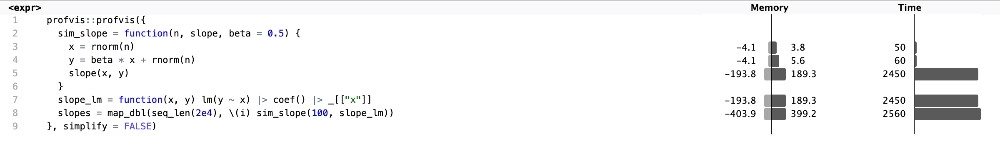
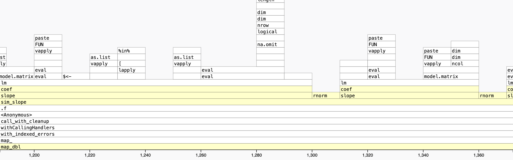

```{r setup}
#| message: false
#| warning: false
#| include: false
library(dplyr)
library(purrr)
library(mirai)
library(parallel)
library(ggplot2)

options(
  width = 80,
  pillar.print_max = 6,
  pillar.print_min = 6
)

knitr::opts_chunk$set(
  fig.align = "center", fig.retina = 2, dpi = 150,
  out.width = "100%"
)

# Python must be initialized while the working directory still holds .venv
reticulate::use_virtualenv(normalizePath(".venv"), required = TRUE)

ggplot2::theme_set(ggplot2::theme_bw())
```


# Profiling

## Measure first

Intuition about where a program spends its time is often wrong. 

Before rewriting anything,

* profile the whole task to find the slow part,

* benchmark alternatives for that part,

* then decide whether parallelization is worth it.

Most of the time the fix is a better algorithm or a vectorized call, not more cores.

## A first attempt

The sampling distribution of a regression slope. `sim_slope()` simulates one dataset and hands it to a function that estimates the slope, and we repeat that 20,000 times,

::: {.xsmall}
```{r}
sim_slope = function(n, slope, beta = 0.5) {
  x = rnorm(n)
  y = beta * x + rnorm(n)
  slope(x, y)
}
slope_lm = function(x, y) lm(y ~ x) |> coef() |> _[["x"]]
```
:::

::: {.xsmall}
```{r sim_lm}
#| cache: true
system.time({ slopes = map_dbl(seq_len(2e4), \(i) sim_slope(100, slope_lm)) })
```
:::

A few seconds for 20,000 fits of 100 points each. Is it the random numbers, the fit, or the map?


## `profvis`

::: {.xsmall}
```{r}
#| eval: false
profvis::profvis({
  sim_slope = function(n, slope, beta = 0.5) {
    x = rnorm(n)
    y = beta * x + rnorm(n)
    slope(x, y)
  }
  slope_lm = function(x, y) lm(y ~ x) |> coef() |> _[["x"]]
  slopes = map_dbl(seq_len(2e4), \(i) sim_slope(100, slope_lm))
}, simplify = FALSE)
```
:::

::: {.panel-tabset}
### Line profile

{fig-align="center" width="100%"}

### Flame graph

{fig-align="center" width="100%"}
:::


## Reading the profile

`profvis::profvis()` runs an expression while recording the call stack every 10 ms, then reports how often each line and function was on the stack. The functions are defined inside the profiled block so their lines appear in the code panel.

* The code panel attributes time and memory to each line. Nearly all of it lands on the `lm()` line, and the random draws barely register.

* The flame graph shows the call stack over time, zoomed here to a 175 ms window. Inside `lm()` the time goes to `model.frame()`, `model.matrix()`, and evaluating the formula. `lm.fit()`, which does the arithmetic, is a thin slice.

* Hovering a bar gives the function and its time, and the Data tab gives the same information as a tree.

::: {.aside}
`profvis` is a sampling profiler built on `Rprof()`. Code that runs for less than a few samples will not show up, so profile a realistic input or wrap a fast call in a loop.
:::


## The fix

The formula interface costs about 100 µs per call however small the data. `lm.fit()` takes the design matrix directly, and a simple regression slope is just `cov(x, y) / var(x)`,

::: {.xsmall}
```{r}
slope_fit = function(x, y) lm.fit(cbind(1, x), y) |> _$coefficients[[2]]
slope_cov = function(x, y) cov(x, y) / var(x)
```
:::

::: {.xsmall}
```{r}
system.time({ slopes = map_dbl(seq_len(2e4), \(i) sim_slope(100, slope_fit)) })
system.time({ slopes = map_dbl(seq_len(2e4), \(i) sim_slope(100, slope_cov)) })
```
:::

Both are about ten times faster. The profile pointed at the overhead around the fit, not the fit itself.


# Benchmarking

## `bench::mark()`

Once there are alternatives, `bench::mark()` runs each expression repeatedly and summarizes the timings and memory use. By default it first checks that every expression returns the same result,

::: {.xsmall}
```{r}
x = rnorm(100)
y = 0.5 * x + rnorm(100)
```
:::

::: {.xsmall}
```{r bench_slope}
#| cache: true
#| warning: false
(b = bench::mark(
  lm = slope_lm(x, y),
  lm.fit = slope_fit(x, y),
  cov_var = slope_cov(x, y)
))
```
:::

::: {.aside}
`check = TRUE` compares results with `all.equal()`. Pass a function instead when differences in order or class are expected. Checking happens outside the timed iterations.
:::


## What is reported

::: {.medium}
| Column       | Meaning                                                             |
|--------------|---------------------------------------------------------------------|
| `min`, `median` | Fastest and typical time per iteration                           |
| `itr/sec`    | Iterations per second, the inverse of the mean time                 |
| `mem_alloc`  | Memory allocated by one iteration                                   |
| `gc/sec`     | Garbage collections per second                                      |
| `n_itr`      | Iterations retained after garbage collection filtering             |
| `n_gc`       | Garbage collections across all iterations                          |
| `total_time` | Total time of the retained iterations                              |
:::

Each expression runs until `min_time` (0.5 s) has passed or `max_iterations` (10,000) is reached, so slow expressions get few iterations and fast ones get many.

::: {.aside}
`summary(b, relative = TRUE)` divides each numeric summary column by its minimum. For `itr/sec`, the slowest expression gets 1. `plot(b)` draws the distribution of timings for each expression.
:::


## `bench::press()`

How does the cost of one fit change with the number of points?

::: {.xsmall}
```{r press}
#| cache: true
#| message: false
#| warning: false
p = bench::press(
  n = c(10, 100, 1000, 10000, 100000),
  {
    x = rnorm(n)
    y = 0.5 * x + rnorm(n)
    bench::mark(
      lm = slope_lm(x, y),
      lm.fit = slope_fit(x, y),
      cov_var = slope_cov(x, y),
      min_time = 0.1
    )
  }
)
```
:::

`press()` runs the benchmark at every combination of parameter values, here just the five sizes.


## Scaling the same task

```{r}
#| echo: false
#| fig-width: 8
#| fig-height: 4
#| out-width: 75%
p |>
  mutate(method = as.character(expression)) |>
  ggplot2::ggplot(ggplot2::aes(n, as.numeric(median), color = method,
                             group = method)) +
  ggplot2::geom_line() +
  ggplot2::geom_point() +
  ggplot2::scale_x_continuous(breaks = c(0, 25e3, 50e3, 75e3, 1e5),
                              labels = c("0", "25k", "50k", "75k", "100k")) +
  ggplot2::labs(x = "Points", y = "Median seconds", color = NULL) +
  ggplot2::theme(legend.position = "bottom")
```

Up to a few thousand points the fixed cost of `lm()` dominates. Past that the arithmetic grows with `n` and the three converge.


# Parallelization

## Why

Most machines have many cores and R uses one of them (mostly). Tasks that split into independent pieces can make use of the multiple cores,

* simulation studies and bootstrap resampling,

* cross validation and tuning grids,

* fitting the same model to many groups,

* processing many files.

. . .

Each piece has a cost beyond the computation itself, starting a process, sending it the data it needs, and sending the result back. Parallelization helps when the pieces are slow relative to that overhead.


## `detectCores()`

The `parallel` package is part of base R and reports the number of cores it can see, as does `os` in Python,

:::: {.columns .xsmall}
::: {.column width='50%'}
```{r}
parallel::detectCores()
```
:::
::: {.column width='50%'}
```{python}
import os
os.cpu_count(), os.process_cpu_count()
```
:::
::::

Treat this number as an upper bound rather than a target,

* it counts logical cores. `detectCores(logical = FALSE)` gives the physical count,

* recent CPUs mix performance and efficiency cores, and work on the slow cores runs slower,

* a multithreaded BLAS, `data.table`, `duckdb`, and `polars` already use several cores, so workers running them oversubscribe the machine,

* on a shared server the count is for the whole machine, and other users need cores too.


## A realistic task

Bootstrapping refits a model to repeated resamples of the data. Here the model is a `loess` smooth of 1,000 noisy points on two cycles of a sine curve, and we want a bootstrap prediction band for new observations on a grid of `x` values,

::: {.xsmall}
```{r}
set.seed(3212016)
d = tibble(x = runif(1000)) |>
  mutate(y = sin(4 * pi * x) + rnorm(1000))
grid = seq(0.01, 0.99, by = 0.01)
```
:::

```{r}
#| echo: false
#| fig-width: 8
#| fig-height: 2.5
#| out-width: 70%
fit = loess(y ~ x, data = d, span = 0.3)
pred = predict(fit, newdata = tibble(x = grid), se = TRUE)
pred_int = tibble(x = grid, y = pred$fit) |>
  mutate(
    se_pred = sqrt(pred$se.fit^2 + pred$residual.scale^2),
    lower = y - qt(0.975, pred$df) * se_pred,
    upper = y + qt(0.975, pred$df) * se_pred
  )
ggplot(d, aes(x, y)) +
  geom_point(alpha = 0.2) +
  geom_ribbon(aes(ymin = lower, ymax = upper), data = pred_int, fill = "red", alpha = 0.3) +
  geom_line(data = pred_int, color = "red")
```


## One replicate

`boot_fit()` fits the smooth to one resample, predicts on the grid, and adds a resampled residual to each prediction to simulate a new observation. The resamples themselves are drawn up front,


::: {.columns .mxsmall}
::: {.column width=66%}
```{r}
boot_fit = function(b, grid, span = 0.3) {
  fit = loess(y ~ x, data = b, span = span)
  pred = predict(fit, newdata = tibble::tibble(x = grid))
  tibble::tibble(
    span = span, 
    x = grid,
    y_new = pred + sample(residuals(fit), length(grid), replace = TRUE)
  )
}
boots = map(
  seq_len(1000), 
  \(i) slice_sample(d, prop = 1, replace = TRUE)
)
```
:::

::: {.column width=33%}
```{r}
boot_fit(boots[[1]], grid)
```
:::
:::

::: {.aside}
The `tibble` calls in `boot_fit()` are namespaced because it will later run in fresh R processes where the package is not attached.
:::


## `mclapply()`

Each replicate is independent and 1,000 take a while,

::: {.xsmall}
```{r boot_seq}
#| cache: true
(time_seq = system.time(lapply(boots, boot_fit, grid = grid)))
```
:::

. . .

`parallel::mclapply()` is `lapply()` across forked copies of the session,

:::: {.columns .xsmall}
::: {.column width='50%'}
```{r boot_mc2}
#| cache: true
(time_mc2 = system.time(
  mclapply(boots, boot_fit, grid = grid,
           mc.cores = 2)
))
```

```{r boot_mc6}
#| cache: true
(time_mc6 = system.time(
  mclapply(boots, boot_fit, grid = grid,
           mc.cores = 6)
))
```
:::

::: {.column width='50%'}
```{r boot_mc4}
#| cache: true
(time_mc4 = system.time(
  mclapply(boots, boot_fit, grid = grid,
           mc.cores = 4)
))
```

```{r boot_mc8}
#| cache: true
(time_mc8 = system.time(
  mclapply(boots, boot_fit, grid = grid,
           mc.cores = 8)
))
```
:::
::::

## Forking

`fork()` duplicates the running process. The child is a copy of the parent at that instant, with the same objects, packages, and point of execution.

* The copy is cheap. Memory is shared copy-on-write, so data that is only read costs nothing extra per worker.

* Nothing is sent to a worker. Each child computes its share, sends the result back through a pipe, and exits.

* Windows has no `fork()`, so `mclapply()` runs sequentially there. `parLapply()` and `mirai` start fresh R sessions instead and send them what they need.

* Only the calling thread is copied, so forking from a session with other threads (a GUI, a multithreaded BLAS) can leave the child broken. RStudio warns about this.


## Forking & Random numbers

Each forked worker starts from a copy of the parent's RNG state. With the default generator, `mclapply()` reseeds each worker from the clock, so results change from run to run even after `set.seed()`.

::: {.xsmall}
```{r}
draw = function() unlist(mclapply(1:3, \(i) rnorm(1), mc.cores = 2))
```
:::

:::: {.columns .xsmall}
::: {.column width='50%'}
```{r}
set.seed(1234)
draw()
set.seed(1234)
draw()
```
:::

::: {.column width='50%' .fragment}
```{r}
RNGkind("L'Ecuyer-CMRG")
set.seed(1234)
draw()
set.seed(1234)
draw()
```
:::
::::

```{r}
#| include: false
RNGkind("default")
```

::: {.aside}
L'Ecuyer-CMRG is a generator that can produce independent streams, which is what the workers need. `mclapply()` gives each worker its own stream, so the result no longer depends on the clock.
:::


# {#mirai-logo data-menu-title="mirai" .nostretch}

{fig-align="center" width="32%"}


## `mirai`

`mirai` is a framework for asynchronous and parallel evaluation of R code,

* code is sent to persistent background R processes (daemons) and the result is collected when needed,

* works the same on every operating system, and daemons can run on remote machines or an HPC cluster,

* errors in a task are returned as values rather than stopping everything,

* it is the engine behind parallel maps in `purrr` and `tidymodels`, and asynchronous tasks in Shiny.

::: {.aside}
See [mirai.r-lib.org](https://mirai.r-lib.org/). The name is Japanese for future.
:::


## `daemons()`

Daemons are set once per session. They sit idle until given work, so there is no reason to start and stop them.

::: {.xsmall}
```{r}
daemons(4)
info()
```
:::

* `daemons(0)` stops and removes all existing daemons. 

* Calling `daemons(n)` creates `n` new daemons.

* `daemons(sync = TRUE)` runs every task in the current session, which is useful for debugging.

::: {.aside}
By default the daemons connect through a dispatcher process that hands each task to the next free daemon.
:::


## `mirai()`

`mirai()` sends an expression to a daemon and returns immediately. The session is free while the task runs.

A mirai is unresolved until the daemon returns a value. `m[]` waits (blocks) for the result, and `m$data` holds it once resolved.

:::: {.columns .xsmall}
::: {.column width='50%'}
```{r}
(m = mirai(
  boot_fit(b, grid),
  boot_fit = boot_fit,
  b = boots[[1]], grid = grid
))
unresolved(m)
```
:::

::: {.column width='50%' .fragment}
```{r}
m[]
m
```
:::
::::


## What a daemon can see

The expression runs in a fresh R process, not in your session, so everything it uses must be sent along or loaded there.

::: {.xsmall}
```{r}
y = 10
```
:::

:::: {.columns .xsmall}
::: {.column width='50%'}
```{r}
mirai(x + y, x = 1)[]
```
:::

::: {.column width='50%'}
```{r}
mirai(x + y, x = 1, y = y)[]
```
:::
::::

Named arguments after the expression are assigned in the daemon. Use `.args = list(...)` instead for objects that should be local to that one evaluation.

. . .

This is why the previous call passed `boot_fit`, `b`, and `grid`. A forked worker would have inherited them, but a daemon starts empty, so the function and its data must be shipped along with the expression.

::: {.aside}
Only pass what the task needs. Every object is serialized and sent to the daemon, so a large data frame that is not used is pure overhead.
:::


## Packages on daemons {.wrap-output}

Functions from packages must be namespaced, sent along like any other object, or the package attached on the daemons with `everywhere()`,

::: {.xsmall}
```{r}
tb = tibble(a = 1:3)
```
:::

:::: {.columns .xsmall}
::: {.column width='50%'}
```{r}
mirai(mutate(tb, b = a * 2), tb = tb)[]
```
:::

::: {.column width='50%' .fragment}
```{r}
mirai(dplyr::mutate(tb, b = a * 2),
      tb = tb)[]
```
:::
::::

. . .

:::: {.columns .xsmall}
::: {.column width='50%'}
```{r}
mirai(mutate(tb, b = a * 2),
      tb = tb, mutate = dplyr::mutate)[]
```
:::

::: {.column width='50%' .fragment}
```{r}
everywhere(library(dplyr))
mirai(mutate(tb, b = a * 2), tb = tb)[]
```
:::
::::


## Between tasks

Each task runs in a fresh environment, and afterwards the daemon restores its global environment, packages, and options. With one daemon both tasks below run in the same process,

::: {.xsmall}
```{r}
daemons(1)
```
```{r}
mirai({
  library(stringr)
  leftover = 42
})[]
```
:::

::: {.xsmall}
```{r}
mirai(c(
  stringr = "package:stringr" %in% search(),
  leftover = exists("leftover")
))[]
```
:::

::: {.aside}
`everywhere()` is the exception. Packages it attaches and objects passed to it by name stay until `daemons(0)`.
:::

```{r}
#| include: false
daemons(4)
```


## `mirai_map()`

`mirai_map()` is `lapply()` where each element becomes its own mirai. Arguments that are the same for every task go in `.args`,

::: {.xsmall}
```{r}
(mm = mirai_map(boots, boot_fit, .args = list(grid = grid)))
```
:::

. . .

::: {.xsmall}
```{r}
res = mm[]
bind_rows(res, .id = "rep")
```
:::


## Time the whole map

`mclapply()` blocks until every result is back, so wrapping it in `system.time()` measured the whole job. `mirai_map()` returns as soon as the tasks are submitted, so the timer has to run from submission through collection with `[]`.

Starting daemons also takes a moment, since each one is a new R process. `everywhere(NULL, .min = workers)` evaluates a no-op on every daemon, and collecting it waits until all of them have connected, which keeps startup out of the timing.

::: {.xsmall}
```{r boot_mirai_times}
#| cache: false
time_mirai_map = function(workers) {
  daemons(workers)
  everywhere(NULL, .min = workers)[]
  system.time(
    mirai_map(boots, boot_fit, .args = list(grid = grid))[]
  )
}
time_mirai = map(c(2, 4, 6, 8), time_mirai_map)
map_dbl(time_mirai, "elapsed")
```
:::


## Compare elapsed times

::: {.xsmall .center}
```{r}
#| echo: false
tibble(
  method = c("lapply", rep("mclapply", 4), rep("mirai_map", 4)),
  workers = c(1, 2, 4, 6, 8, 2, 4, 6, 8),
  seconds = c(
    time_seq[["elapsed"]],
    map_dbl(list(time_mc2, time_mc4, time_mc6, time_mc8), "elapsed"),
    map_dbl(time_mirai, "elapsed")
  )
) |>
  mutate(speedup = first(seconds) / seconds) |>
  print(n = Inf)
```
:::

The speedup is sublinear in the number of workers for both, and `mclapply()` edges out `mirai_map()` at every count. This is close to an ideal case for forking. The workers inherit the resamples, the grid, and `boot_fit()` for free, where `mirai` has to send each resample to a daemon.


## Aside - Scheduling

::: {.medium}
Eight tasks on four workers, where each task does nothing but sleep for a set number of seconds.
:::

::: {.xsmall}
```{r}
waits = c(1, 1, 4, 4, 1, 1, 1, 4)
```
:::

::: {.medium}
How long does this take if the tasks are dealt out in order (round robin) or if instead each task goes to the first free worker?
:::

::: {.fragment}
:::: {.panel-tabset}
### Diagram

```{r}
#| echo: false
#| fig-width: 10
#| fig-height: 3.5
#| out-width: 75%
schedule = function(dynamic) {
  free = numeric(4)
  rows = vector("list", length(waits))
  for (i in seq_along(waits)) {
    worker = if (dynamic) which.min(free) else (i - 1) %% 4 + 1
    rows[[i]] = tibble(task = i, worker = worker, start = free[worker],
                       end = free[worker] + waits[i])
    free[worker] = free[worker] + waits[i]
  }
  bind_rows(rows)
}
schedules = bind_rows(
  "Fixed assignment (8 s)" = schedule(FALSE),
  "Next free worker (6 s)" = schedule(TRUE), .id = "strategy"
)
ggplot2::ggplot(schedules) +
  ggplot2::geom_rect(ggplot2::aes(xmin = start, xmax = end,
    ymin = worker - 0.35, ymax = worker + 0.35, fill = factor(end - start)),
    color = "white") +
  ggplot2::geom_text(ggplot2::aes((start + end) / 2, worker, label = task),
                     color = "white", size = 4) +
  ggplot2::facet_wrap(~strategy, ncol = 2) +
  ggplot2::scale_x_continuous(breaks = 0:8, limits = c(0, 8)) +
  ggplot2::scale_y_reverse(breaks = 1:4) +
  ggplot2::scale_fill_manual(values = c("#2878a0", "#955196"), guide = "none") +
  ggplot2::labs(x = "Seconds (numbers inside bars identify tasks)", y = "Worker")
```

### Timings

::: {.mxsmall}
```{r}
#| cache: true
system.time(mclapply(waits, Sys.sleep, mc.cores = 4))
system.time(mclapply(waits, Sys.sleep, mc.cores = 4, mc.preschedule = FALSE))
daemons(4)
system.time(mirai_map(waits, Sys.sleep)[])
```
:::
::::
:::

::: {.aside}
`mclapply()` deals tasks in order by default. `mc.preschedule = FALSE` uses the next free worker, as `mirai` does.
:::


## Daemons on other machines

The same code runs with daemons on remote machines. The host listens at a URL and the daemons dial in, launched over SSH or submitted through a cluster scheduler.

::: {.xsmall}
```{r}
#| eval: false
daemons(
  url = host_url(),
  remote = ssh_config(c("ssh://hypatia", "ssh://germain"))
)

daemons(
  n = 20, url = host_url(),
  remote = cluster_config(command = "sbatch", options = "#SBATCH --mem=4G")
)
```
:::

::: {.aside}
See the [distributed computing](https://mirai.r-lib.org/articles/mirai.html#distributed-computing) section of the `mirai` docs. `remote_config()` builds a launch command for any other system.
:::


# `mirai` and the tidyverse

```{r}
#| include: false
daemons(4)
```


## `in_parallel()`

::: {.medium}
`purrr`'s `in_parallel()` wraps the function given to any `map()` variant. When daemons are set the map runs through `mirai`, otherwise it runs sequentially.
:::

::: {.mxsmall}
```{r}
system.time({
  res = tibble(b = boots) |>
    mutate(
      fit = map(b, 
        in_parallel(\(b) boot_fit(b, grid), boot_fit = boot_fit, grid = grid)
      )
    )
})
```
:::

::: {.medium}
* `in_parallel()` creates a self-contained function (a crate) that is serialized and sent to the daemons.

* `mirai_map()` can be called directly instead, and over a data frame it maps across rows like `pmap()`. `in_parallel()` works with the whole `map()` family, so it fits inside `mutate()` and keeps `purrr`'s type-stable variants.
:::

::: {.aside}
This is experimental in `purrr` 1.2 but is the direction the tidyverse is taking for parallel maps.
:::


## Self-contained functions

Use of `in_parallel()` has similar limits to direct use of `mirai()`,

::: {.medium}
* Package functions must be namespaced, `dplyr::filter()` rather than `filter()`, or the package attached inside the function.

* Objects and helper functions from your session must be passed to `in_parallel()` by name, as in `in_parallel(\(x) f(x), f = f)`. Helpers passed this way must themselves be self-contained.

* `map()`'s `...` is not available for a parallel map, so `map(boots, in_parallel(boot_fit), grid = grid)` does not work. Fix extra arguments inside the lambda instead, as in `\(b) boot_fit(b, grid)`, with `grid` passed to `in_parallel()` by name.
:::

::: {.xsmall}
```{r}
#| error: true
map(boots[1:3], in_parallel(\(b) boot_fit(b, grid)))
```
:::

::: {.aside}
`in_parallel()` is a thin wrapper around `carrier::crate()`, whose documentation covers the rules in more detail.
:::


## Bootstrap band

Unnest the fits and summarize by `x` to get the bootstrap prediction band, shown in red. The blue band is the prediction interval from the `loess()` fit to the original data,

::: {.xsmall}
```{r}
band = res |>
  select(fit) |>
  tidyr::unnest(fit) |>
  summarize(
    lower = quantile(y_new, 0.025, na.rm = TRUE),
    upper = quantile(y_new, 0.975, na.rm = TRUE),
    .by = x
  )
```
:::

```{r}
#| echo: false
#| fig-width: 8
#| fig-height: 2.8
#| out-width: 75%
ggplot(d, aes(x, y)) +
  geom_point(alpha = 0.15) +
  geom_ribbon(
    aes(x = x, ymin = lower, ymax = upper), data = pred_int,
    fill = "blue", alpha = 0.3, inherit.aes = FALSE
  ) +
  geom_ribbon(
    aes(x = x, ymin = lower, ymax = upper), data = band,
    fill = "red", alpha = 0.3, inherit.aes = FALSE
  )
```


## When it does not help

For small calculations, compare a vectorized call, a sequential map, and a parallel map,

::: {.xsmall}
```{r}
daemons(4)
x = runif(1e4)
```

```{r tiny_tasks}
#| cache: true
bench::mark(
  vectorized = sqrt(x) + 1,
  sequential = map_dbl(x, \(v) sqrt(v) + 1),
  parallel = map_dbl(x, in_parallel(\(v) sqrt(v) + 1)),
  iterations = 3, filter_gc = FALSE
) |>
  select(expression, median)
```
:::


```{r}
#| include: false
daemons(0)
```


# Python

## The Python toolkit

The workflow is the same, measure first and then decide whether workers are worth it. The Python equivalents are mostly in the standard library,

::: {.medium}
| Task                                  | R                                | Python                  |
|---------------------------------------|----------------------------------|-------------------------|
| Profile                               | `profvis`                        | `cProfile` and `pstats` |
| Time a call                           | `bench::mark()`                  | `timeit`                |
| Pools of workers                      | `mclapply()`, `mirai_map()`      | `concurrent.futures`    |
| Persistent workers, session functions | `mirai` daemons, `in_parallel()` | `joblib`                |
:::

The rest of this section repeats the bootstrap, profiles a replicate, and then compares sequential, thread, and process execution of the same tasks.


## `boot_fit()` in Python

The smoother is now `lowess()` from `statsmodels`. Compared to the R version, `boot_fit()` takes a seed rather than a resample and draws the resample itself. A seed is a small thing to send to a worker, where a 1,000 row data frame is not, and the next slides use it to make each task reproducible.

The function lives in its own module, `data/boot_fit.py`, because a pool of processes imports the task function in each worker instead of copying the session the way a fork does,

::: {.xsmall}
```{python}
#| eval: false
#| file: data/boot_fit.py
```
:::

::: {.aside}
`it = 0` skips the robustness iterations to match R's `loess()`, and `xvals` evaluates the fit on the grid.
:::


## The same data

The same points and prediction grid as in R, and one replicate from the imported function,

::: {.xsmall}
```{python}
import numpy as np
import pandas as pd
from data.boot_fit import boot_fit

rng = np.random.default_rng(3212016)
x = rng.uniform(size = 1000)
d = pd.DataFrame({"x": x, "y": np.sin(4 * np.pi * x) + rng.normal(size = 1000)})
grid = np.linspace(0.01, 0.99, 99)
```

```{python}
boot_fit(1, d, grid)[:5]
```
:::


## Profile before adding workers

`cProfile` is Python's profiler and `pstats` summarizes what it recorded. Profiling 100 replicates and sorting the calls by cumulative time shows where the time goes,

::: {.mxsmall}
```{python}
import cProfile, pstats

with cProfile.Profile() as pr:
  fits = [boot_fit(seed, d, grid) for seed in range(100)]

_ = pstats.Stats(pr).strip_dirs().sort_stats("cumulative").print_stats(4)
```
:::

Nearly all of the time is inside the two `lowess()` calls. That is library code we cannot rewrite, so the practical option here is more workers.

::: {.aside}
`tottime` excludes called functions, `cumtime` includes them. Profiling adds overhead, so time improvements without it.
:::


## Random streams

Each worker process has its own copy of the global generator, either copied from the parent or freshly seeded, so `np.random.seed()` in the session does not make the results reproducible. This is the same problem as with forked R workers.

The fix mirrors L'Ecuyer streams. `SeedSequence.spawn()` derives independent streams from one seed, and `boot_fit()` builds its generator from the stream it is given,

::: {.xsmall}
```{python}
reps = 1000
seeds = np.random.SeedSequence(42).spawn(reps)
seeds[0]
```
:::

A stream belongs to its task, so worker count and scheduling do not change the draws,

::: {.xsmall}
```{python}
np.array_equal(boot_fit(seeds[0], d, grid), boot_fit(seeds[0], d, grid))
```
:::


## Sequential baseline

Every strategy below is compared against a sequential run, the Python counterpart of the `lapply()` timing. `partial()` fixes the arguments shared by every task, so `fit(seed)` is a complete task with a single argument, which is what `map()` and the worker pools expect.

`timeit.timeit()` with `number = 1` times one run and discards its result, so the fits are kept from a separate call,

::: {.xsmall}
```{python}
from functools import partial
import timeit

fit = partial(boot_fit, d = d, grid = grid)
sequential = list(map(fit, seeds))

sequential_seconds = timeit.timeit(lambda: list(map(fit, seeds)), number = 1)
sequential_seconds
```
:::


## Threads, processes, and the GIL

R's forks and daemons are both processes. Python also offers threads, which share one interpreter, and whether they help depends on the global interpreter lock (GIL),

* With the GIL enabled, only one thread runs Python code at a time. Threads overlap waiting, but do not speed up computation written in Python.

* Compiled code can release the GIL while it runs, but only if it was written to. Measure rather than assume.

* Processes have separate interpreters and GILs. Starting them and transferring inputs and results costs time.

::: {.aside}
Free threaded Python became officially supported in 3.14 and remains optional. Extension compatibility varies. Vectorization alone does not imply multiple threads; most `numpy` operations use one thread per call.
:::


## Compare execution strategies

`concurrent.futures` provides a thread pool and a process pool with the same interface. The `with` block starts the workers and shuts them down at the end, and `pool.map()` spreads the calls across them and returns the results in input order,

::: {.xsmall}
```{python py_executors}
#| cache: false
from concurrent.futures import ProcessPoolExecutor, ThreadPoolExecutor

def run(executor):
  with executor(max_workers = 4) as pool:
    return list(pool.map(fit, seeds))

runs = [("sequential", sequential_seconds)]
for executor in [ThreadPoolExecutor, ProcessPoolExecutor]:
  seconds = timeit.timeit(lambda: run(executor), number = 1)
  assert np.array_equal(run(executor), sequential)
  runs.append((executor.__name__, seconds))
```
:::

The timings include pool startup and shutdown. `timeit` discards the return value, so each executor runs a second time to check every fitted value against the sequential run. Only the execution changes, not the tasks or their results.

::: {.aside}
Process workers import `boot_fit` from its module. In a script, create the pool under `if __name__ == "__main__":`.
:::


## Does parallelization still help?

Speedup is the sequential time divided by each method's time,

::: {.xsmall}
```{python}
comparison = pd.DataFrame(runs, columns = ["method", "seconds"])
comparison["speedup"] = sequential_seconds / comparison["seconds"]
comparison
```
:::

Threads take as long as the sequential run. `lowess()` is Python code, so only one thread holds the GIL at a time.

Four processes finish in well under half the time, and that includes starting four interpreters that each import `statsmodels`. The next slides measure that startup cost.


## `joblib` and repeated calls

`joblib` is the package `scikit-learn` uses for parallel work, and it lifts two limits of the process pool. Its default backend can send functions defined in the session, like `in_parallel()`'s crate, and it keeps the workers alive between calls, like daemons.

`delayed(fit)(seed)` records a call without running it and `Parallel` runs the batch. Timing two calls in a row shows the effect of reusing the workers,

::: {.xsmall}
```{python}
from joblib import Parallel, delayed

def run_joblib():
  return Parallel(n_jobs = 4)(delayed(fit)(seed) for seed in seeds)

joblib_seconds = [timeit.timeit(run_joblib, number = 1) for _ in range(2)]
assert np.array_equal(run_joblib(), sequential)
```
:::


## Account for startup

::: {.xsmall}
```{python}
pd.DataFrame({"call": ["first", "repeated"], "seconds": joblib_seconds})
```
:::

The first call starts four workers that each import the task's modules. The repeated call reuses them, so it is faster again. Both calls run the same tasks and reproduce the sequential results.

For a one-off script, include startup in the comparison. For repeated work in a session, also measure a call with workers already running.

```{python}
#| include: false
from joblib.externals.loky import get_reusable_executor
get_reusable_executor().shutdown(wait = True)
```


# Summary {visibility="uncounted"}

## Takeaways {visibility="uncounted"}

::: {.medium}
* Profile before optimizing. `profvis` attributes time to lines of your code, and the slow line is rarely the one you expect. A better algorithm usually beats more cores.

* Check that alternatives do the same work before comparing speed. `bench::mark()` checks results, and `bench::press()` varies input size and group count.

* `mclapply()` forks the session for parallel `lapply()` on Unix. Its default fixed assignment can leave cores idle; `mc.preschedule = FALSE` schedules tasks as slots free up.

* Time asynchronous work from submission through collection. `mirai` returns errors as values, so successful results can be kept while failed tasks are repaired and retried.

* `purrr::in_parallel()` and `mirai_map()` put parallel work inside pipelines. Assign reproducible random streams to tasks so worker count does not change the results.

* In Python, measure threads and processes on the real workload, accounting for pool startup and worker reuse. Threads only help when the hot code releases the GIL.
:::


## Learning more {visibility="uncounted"}

::: {.medium}
- [profvis](https://profvis.r-lib.org/) and the [Measuring performance](https://adv-r.hadley.nz/perf-measure.html) chapter of Advanced R
- [bench](https://bench.r-lib.org/)
- [mirai](https://mirai.r-lib.org/), with articles on [daemons](https://mirai.r-lib.org/articles/mirai.html) and [parallel maps](https://mirai.r-lib.org/articles/mirai-map.html)
- [Parallelization in purrr](https://purrr.tidyverse.org/reference/in_parallel.html)
- [concurrent.futures](https://docs.python.org/3/library/concurrent.futures.html) and [joblib](https://joblib.readthedocs.io/)
- [Parallel random streams in NumPy](https://numpy.org/doc/stable/reference/random/parallel.html)
:::


# Reference {visibility="uncounted"}

## Quick Python timings {visibility="uncounted"}

In Jupyter and IPython, `%timeit` chooses the number of loops and repeats itself,

::: {.xsmall}
```python
%timeit boot_fit(1, d, grid)
```
:::

With `timeit.repeat()`, take the minimum as an estimate of execution time with the least interference from other work on the machine.


## Timeouts and cancellation {visibility="uncounted"}

A timeout returns an error value. With a dispatcher, it also cancels the task.

::: {.xsmall}
```{r}
#| eval: false
daemons(4)
m = mirai(Sys.sleep(10), .timeout = 500)
m[]
is_error_value(m$data)
```
:::

`.timeout` is in milliseconds. `stop_mirai()` cancels a task explicitly.


## Task size and nested parallelism {visibility="uncounted"}

`purrr` suggests roughly 100 µs to 1 ms of work per task as a starting point for considering parallelization. Measure on your own workload.

Some libraries already use multiple threads, including `data.table`, `polars`, `duckdb`, and optimized BLAS libraries.

Running multithreaded code in several worker processes can create more runnable threads than available cores. Limit internal threads or reduce the worker count, then measure again.


## Other packages {visibility="uncounted"}

::: {.medium}
* `future` and `furrr` are an older framework with the same idea, a plan is set once and `future_map()` runs on it. `mirai` is now one of its backends.

* `foreach` with `doParallel` or `doMC` is a loop based interface that is still common in older code and packages.

* `parallel::parLapply()` and `makeCluster()` create socket workers that work on Windows but need explicit `clusterExport()` of every object.
:::
