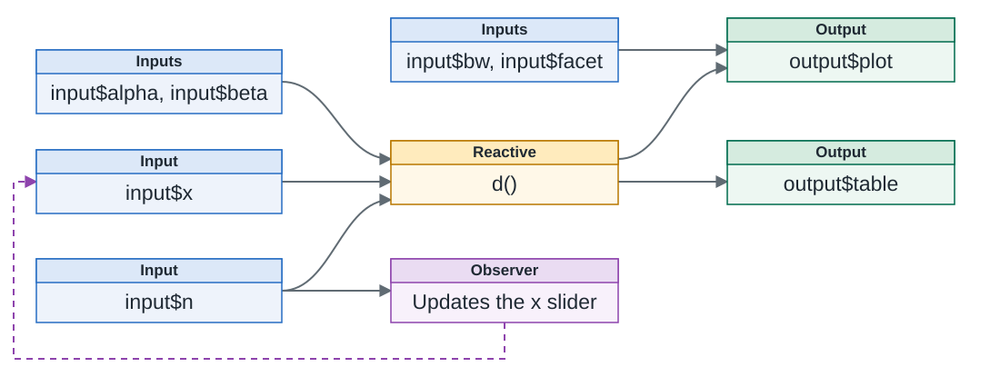

# {#shiny-logo data-menu-title="shiny" .nostretch}

```{r setup}
#| message: false
#| warning: false
#| include: false
library(shiny)
library(bslib)

options(
  width = 80
)

knitr::opts_chunk$set(
  fig.align = "center", fig.retina = 2, dpi = 150,
  out.width = "100%"
)
```

{fig-align="center" width="32%"}


## `shiny`

> Shiny is an R package that makes it easy to build interactive web apps straight from R. You can host standalone apps on a webpage or embed them in R Markdown documents or build dashboards. You can also extend your Shiny apps with CSS themes, htmlwidgets, and JavaScript actions.

::: {.aside}
From [shiny.posit.co/r](https://shiny.posit.co/r/getstarted/)
:::


## Shiny App

<br/>

::: columns
::: {.column width="40%" .larger}
Server

::: {style="border: 2px solid; border-radius: 5px; text-align:center; font-size: 90px; height: 250px"}
`r fontawesome::fa("r-project")` + `r fontawesome::fa("server")`
:::
:::

::: {.column width="20%"}
::: {style="text-align: center; font-size: 90px; padding-top: 20px"}
<br/>⇄
:::
:::

::: {.column width="40%" .larger}
Client / Browser

::: {style="border: 2px solid; border-radius: 5px; text-align: center; height: 250px"}
::: {style="font-size: 90px"}
`r fontawesome::fa("file-code")`
:::

::: {style="font-size: 50px"}
`r fontawesome::fa("html5")` + `r fontawesome::fa("js")` + `r fontawesome::fa("css3")`
:::
:::
:::
:::


## `bslib`

The `bslib` package provides a modern UI toolkit for Shiny, R Markdown, and Quarto based on Bootstrap.

We will be talking more about this package and its features next time. For now we will be loading it alongside `shiny` and using some of its layout features today.

::: {.center}
{width="20%"}
:::

::: {.aside}
If you are confused about where a particular function comes from, in general `shiny` uses `camelCase` while `bslib` uses `snake_case`.
:::


## Anatomy of an App

::: {.small}
```{r shiny-anatomy}
#| eval: false
library(shiny)
library(bslib)

ui = list()

server = function(input, output, session) {

}

shinyApp(ui = ui, server = server)
```
:::

The `ui` describes what the browser shows, a collection of inputs, outputs, and layout. The `server` function describes how the outputs are computed from the inputs.


## Shiny Layouts

::: {style="text-align: center"}
<https://shiny.posit.co/r/layouts/>
:::

<iframe data-src="https://shiny.posit.co/r/layouts/" width="100%" height="500px" style="border:1px solid;border-radius: 5px;" data-external="1">
</iframe>


## Shiny Widgets Gallery

::: {style="text-align: center"}
<https://shiny.posit.co/r/gallery/widgets/widget-gallery/>
:::

<iframe data-src="https://gallery.shinyapps.io/081-widgets-gallery/" width="100%" height="500px" style="border:1px solid;border-radius: 5px;" data-external="1">
</iframe>


## A brief widget tour

::: {style="text-align: center"}
[rundel.shinyapps.io/widgets/](https://rundel.shinyapps.io/widgets/)
:::

<iframe data-src="https://rundel.shinyapps.io/widgets/" width="100%" height="500px" style="border:1px solid;border-radius: 5px;" data-external="1">
</iframe>


# Beta-Binomial app

## App background

I've brought a coin with me to class and I'm claiming that it is fair (equally likely to come up heads or tails).

I flip the coin 10 times and we observe 7 heads and 3 tails, should you believe me that the coin is fair? Or, more generally, what should you believe about the coin's fairness now?


## Model

Let $y$ be the number of successes (heads) in $n$ trials then,

Likelihood,
$$
\begin{aligned}
y|n,p &\sim \text{Binom}(n,p) \\
f(y|n,p) &= {n \choose y} p^y(1-p)^{n-y} \\
         &= \frac{n!}{y!(n-y)!} p^y(1-p)^{n-y}
\end{aligned}
$$

. . .

Prior,
$$
\begin{aligned}
p|a,b &\sim \text{Beta}(a,b) \\
\pi(p|a,b) &= \frac{\Gamma(a+b)}{\Gamma(a)\Gamma(b)} p^{a-1} (1-p)^{b-1}
\end{aligned}
$$


## Posterior

From the definition of Bayes' rule,

$$
\begin{aligned}
f(p|y,n,a,b)
  &= \frac{f(y|n,p) \, \pi(p|a,b)}{\int f(y|n,p) \, \pi(p|a,b) \, dp} \\
  &\propto f(y|n,p) \, \pi(p|a,b) \\
\end{aligned}
$$

. . .

We then plug in the likelihood and prior and simplify by dropping any terms not involving $p$,

$$
\begin{aligned}
f(p|y,n,a,b)
  &\propto \left( \frac{n!}{y!(n-y)!} p^y(1-p)^{n-y} \right)
    \left(\frac{\Gamma(a+b)}{\Gamma(a)\Gamma(b)} p^{a-1} (1-p)^{b-1}\right) \\
  &\propto \Big( p^y(1-p)^{n-y} \Big)
    \Big( p^{a-1} (1-p)^{b-1}\Big) \\
  &\propto p^{y+a-1} (1-p)^{n-y + b-1}
\end{aligned}
$$


## Posterior distribution

Based on the form of the density we can see that the posterior of $p$ must also be a Beta distribution with parameters,

$$
p|y,n,a,b \sim \text{Beta}(y+a, n-y + b)
$$

. . .

and our other distributions

$$
\begin{aligned}
p|a,b &\sim \text{Beta}(a,b) \\
y|n,p &\sim \text{Binom}(n,p)
\end{aligned}
$$

To normalize the likelihood curve, divide by

$$
\begin{aligned}
\int_0^1 f(y|n,p) \, dp
  &= {n \choose y}
    \frac{\Gamma(y+1)\Gamma(n-y+1)}{\Gamma(n+2)} \\
  &= {n \choose y} B(y+1,n-y+1)
\end{aligned}
$$

## Example

Build a Shiny app that lets the user set the data ($y$ heads out of $n$ flips) and the prior ($a$, $b$) and plots the prior, likelihood, and posterior densities along with a table of summary statistics for each.


## The reactive graph

Shiny records dependencies as reactive code runs. A solid arrow `A → B` means that **B depends on A**.

{width="100%" fig-alt="Inputs feed d(), which feeds the plot and table. Display inputs feed only the plot. input$n also feeds an observer, with a dashed update arrow from the observer to input$x."}

::: {.small}
Dependencies in the first Beta-Binomial app, with some inputs grouped. The dashed arrow shows the observer updating the `x` slider in the browser.
:::


## When an input changes

Suppose we change `input$a`.

::: {.medium}
1. `d()` and its dependent outputs are **invalidated**: their previous results are no longer current.
2. When an output next calls `d()`, it recomputes using the new input values.
3. The other output uses the cached result of `d()`; it does not repeat the density calculations.
:::

Reactive expressions are **lazy** and **cached**: invalidating a reactive does not immediately recompute it.

. . .

What needs to run again if we change `input$bw` instead?


## Observers and input updates

Observers run for their **side effects**. When invalidated, they schedule themselves to run; another reactive does not need to call them.

::: {.small}
```{r reactive-graph-observer}
#| eval: false
observe({
  updateSliderInput(session, "x", max = input$n)
}) |>
  bindEvent(input$n)
```
:::

::: {.medium}
* Here, `bindEvent(input$n)` makes `input$n` the observer's dependency.
* The dashed arrow represents the side effect of updating the slider. If the browser reports a changed value for `input$x`, that starts another reactive update.
* Outputs are also implemented using observers: their side effect is to send a result to the browser.
:::


# Summary {visibility="uncounted"}

## Takeaways {visibility="uncounted"}

::: {.medium}
* A Shiny app has two parts, a `ui` that describes what the browser shows and a `server` function that computes outputs from inputs. `shinyApp()` runs them together.

* Inputs are created by `*Input()` functions and read from `input$id` in the server. Outputs are created by `*Output()` functions in the UI and assigned via `render*()` functions to `output$id`.

* Reactive expressions created with `reactive()` cache intermediate results that are shared by several outputs. When a dependency changes, the cached result is invalidated and recomputed the next time it is needed.

* `observe()` runs code for its side effects, such as updating an input with `update*Input()`. `bindEvent()` limits when an observer or reactive runs.

* `bslib` provides page layouts such as `page_sidebar()` and uses `snake_case`, while `shiny` functions use `camelCase`.
:::


## Learning more {visibility="uncounted"}

::: {.medium}
- [Mastering Shiny](https://mastering-shiny.org/) by Hadley Wickham, particularly the chapters on [Basic UI](https://mastering-shiny.org/basic-ui.html), [Basic reactivity](https://mastering-shiny.org/basic-reactivity.html), [The reactive graph](https://mastering-shiny.org/reactive-graph.html), and [Reactive building blocks](https://mastering-shiny.org/reactivity-objects.html)
- [Shiny for R](https://shiny.posit.co/r/getstarted/) getting started guide, [layouts](https://shiny.posit.co/r/layouts/), and [components](https://shiny.posit.co/r/components/)
- [bslib](https://rstudio.github.io/bslib/)
- [Shiny cheatsheet](https://rstudio.github.io/cheatsheets/html/shiny.html)
:::
