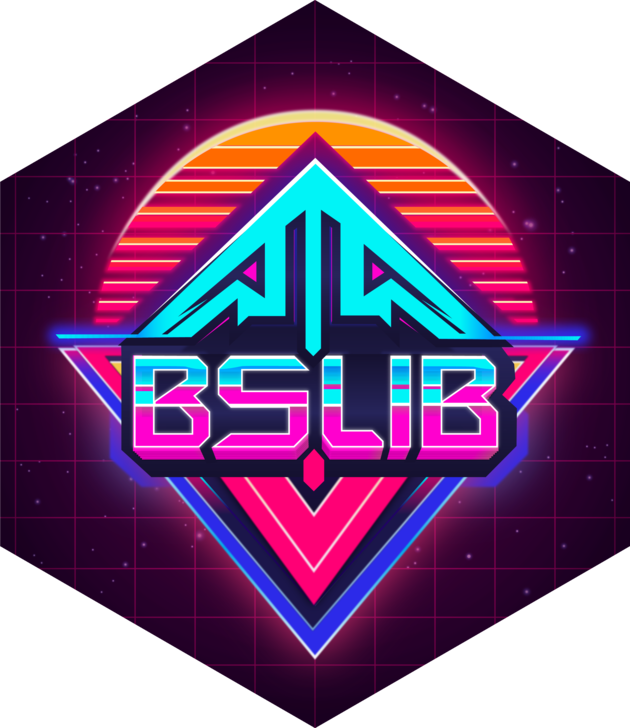
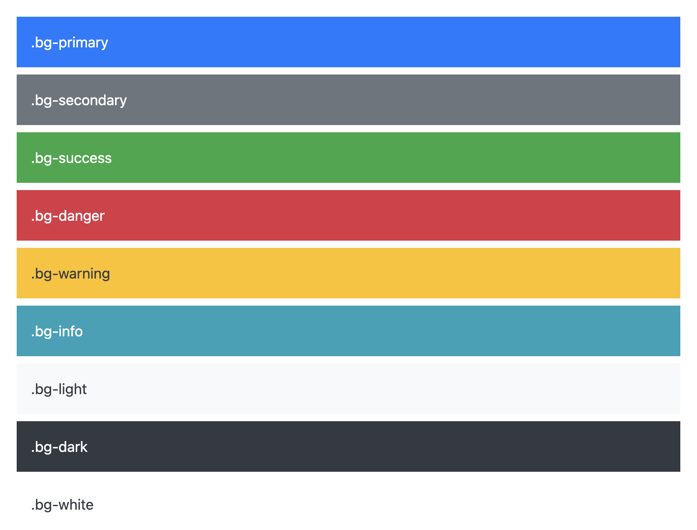

```{r setup}
#| message: false
#| warning: false
#| include: false
library(tidyverse)
library(shiny)
library(bslib)
library(tagframe)

options(
  width = 80
)

knitr::opts_chunk$set(
  fig.align = "center", fig.retina = 2, dpi = 150,
  out.width = "100%"
)
```

# Reactive events

## Action buttons

So far every output has updated as soon as any of its inputs changed. An action button lets the user decide when something should happen instead, such as rerunning a slow calculation.

::: {.small}
```{r run-button}
#| eval: false
actionButton("run", "Run")
```
:::

`input$run` is a count of clicks that starts at 0. The count itself is rarely useful. What matters is that it changes with every click, which invalidates anything that depends on it.


## `bindEvent()`

A reactive normally depends on every input it reads. Piping it into `bindEvent()` replaces those dependencies with the ones we list.

::: {.small}
```{r run-calculation}
#| eval: false
d = reactive({
  tibble(
    p = seq(0, 1, length.out = 1001),
    prior = dbeta(p, input$a, input$b),
    likelihood = dbinom(input$x, input$n, p),
    posterior = dbeta(p, input$a + input$x, input$b + input$n - input$x)
  )
}) |>
  bindEvent(input$run)
```
:::

::: {.medium}
* Changing `a`, `b`, `x`, or `n` no longer invalidates `d()`. Only a click does, and the plot and table that use `d()` then update together.
* Nothing is computed until the first click, so the outputs start out empty. Add `ignoreNULL = FALSE` to also run once at startup.
* Several events can be listed, e.g. `bindEvent(input$run, input$reset)`.
:::


## `eventReactive()` & `observeEvent()`

Older code and many online examples use these two functions instead. Each is equivalent to a `reactive()` or `observe()` piped into `bindEvent()`.

:::: {.columns}
::: {.column width='50%' .small}
```r
d = eventReactive(input$run, {
  ...
})
```
:::

::: {.column width='50%' .small}
```r
d = reactive({
  ...
}) |>
  bindEvent(input$run)
```
:::
::::

:::: {.columns}
::: {.column width='50%' .small}
```r
observeEvent(input$n, {
  ...
})
```
:::

::: {.column width='50%' .small}
```r
observe({
  ...
}) |>
  bindEvent(input$n)
```
:::
::::

Shiny's documentation recommends `bindEvent()` for new code, and it is what we will use in this course. It also works with `render*()` functions, so there is one interface to learn rather than three.


# {#bslib-logo data-menu-title="bslib" .nostretch}

{fig-align="center" width="32%"}

## Shiny & Bootstrap

Shiny's interface is built from the HTML elements, styling, and JavaScript of the [Bootstrap library](https://getbootstrap.com/). You do not need to know Bootstrap to use Shiny, but knowing its conventions makes it much easier to customize an app. R Markdown and Quarto HTML documents use Bootstrap as well.

The `bslib` package is a UI toolkit for all three, built on modern Bootstrap. It provides

* Theming for apps and documents

* A choice of Bootstrap version and Bootswatch themes

* Dashboard components such as cards, value boxes, and sidebars


# `bslib` components

## Cards

Cards are rectangular containers with a border and padding, used to group related content. They are the basic building block of most dashboards.

::: {.mxsmall}
```{bslib}
#| output-location: column
#| height: 170
card(
  card_header("A header"),
  card_body(
    shiny::markdown(
      "Some text with a [link](https://github.com)"
    )
  ),
  card_footer("A footer")
)
```

```{bslib}
#| output-location: column
#| height: 220
card(
  max_height = 200,
  card_header(
    "A long, scrolling, description",
    class = "bg-dark"
  ),
  card_body(
    lorem::ipsum(paragraphs = 3, sentences = 5)
  )
)
```
:::

## Card bodies

A card can hold any content, including widgets and more than one `card_body()`. Bootstrap classes such as `p-0` adjust the padding.

::: {.mxsmall}
```{bslib}
#| output-location: column
#| height: 200
card(
  max_height = 180,
  card_header(
    "A leaflet map",
    class = "bg-success"
  ),
  card_body(
    class = "p-0",
    leaflet::leaflet() |> leaflet::addTiles()
  )
)
```

```{bslib}
#| output-location: column
#| height: 245
card(
  max_height = 225,
  card_header("Two bodies"),
  card_body(
    leaflet::leaflet() |> leaflet::addTiles()
  ),
  card_body(
    lorem::ipsum(paragraphs = 1, sentences = 3)
  )
)
```
:::

## Full screen cards & popovers

`full_screen = TRUE` adds an expand button that appears on hover. `popover()` and `tooltip()` attach extra content to any element, here an icon in the header.

::: {.mxsmall .code-narrow}
```{bslib}
#| output-location: column
#| height: 420
#| width: "96%"
#| scale: 0.8
page_fillable(
  card(fill = FALSE, "A card above"),
  card(
    full_screen = TRUE,
    card_header(
      "A card with settings",
      popover(
        bsicons::bs_icon("gear"),
        title = "Settings",
        "Inputs can go here."
      ),
      class = c(
        "d-flex",
        "justify-content-between"
      )
    ),
    leaflet::leaflet() |>
      leaflet::addTiles()
  ),
  card(fill = FALSE, "A card below")
)
```
:::

## Tabbed cards

`navset_card_tab()` puts several panels in one card. `navset_card_pill()` and `navset_card_underline()` differ only in the style of the tabs.

::: {.xsmall}
```{bslib}
#| output-location: column
#| height: 350
navset_card_tab(
  height = 300,
  nav_panel(
    "Map",
    leaflet::leaflet() |>
      leaflet::addTiles()
  ),
  nav_panel(
    "Text",
    lorem::ipsum(1, 3)
  )
)
```
:::

## Value boxes

A `value_box()` is a card built to show one headline value, with an optional `showcase` icon, a `theme` color, and extra detail text.

::: {.xsmall}
```{bslib}
#| output-location: column
#| height: 310
library(bsicons)

layout_column_wrap(
  width = 1,
  value_box(
    title = "95% interval",
    value = "0.38 - 0.80",
    showcase = bs_icon("arrows-expand"),
    theme = "primary",
    p("Equal tailed")
  ),
  value_box(
    title = "Flips",
    value = "10",
    showcase = bs_icon("coin"),
    showcase_layout = "top right",
    p("7 heads, 3 tails")
  )
)
```
:::


# Layouts

## Fillable containers

`page_fillable()` and `card()` are fillable containers. Children that are fill items grow and shrink to share the container's height.

* Cards, value boxes, and plot outputs are fill items by default
* `fill = FALSE` keeps an item at its natural height
* `min_height` and `max_height` limit how far an item shrinks or grows

::: {.xsmall}
```{bslib}
#| output-location: column
#| height: 300
#| scale: 0.75
page_fillable(
  card(
    card_header("Card 1"),
    "Fills the remaining space."
  ),
  card(
    fill = FALSE,
    card_header("Card 2"),
    "Stays at its natural height."
  )
) |>
  anim_height("100%", "60%")
```
:::

## `page_fillable()`

`page_fillable()` sizes the page to the browser window and shares that height among its children. Each card here shrinks from its `max_height` as the page gets shorter.

::: {.mxsmall .code-narrow}
```{bslib}
#| output-location: column
#| height: 450
#| width: "96%"
#| scale: 0.8
library(leaflet)
page_fillable(
  card(
    max_height = 200,
    card_header("Card 1"),
    lorem::ipsum(1,3)
  ),
  card(
    max_height = 100,
    card_header("Card 2"),
    "This is it."
  ),
  card(
    max_height = 200,
    card_header("Card 3"),
    leaflet() |> addTiles()
  )
) |>
  anim_height("100%", "80%")
```
:::


## Build by rows - `layout_columns()`

`layout_columns()` places its children side by side in a row. Stacking two of them gives two rows, each with its own `height`.

::: {.mxsmall .code-narrow}
```{bslib}
#| output-location: column
#| height: 420
#| width: "96%"
#| scale: 0.8
#| code-line-numbers: "|3-13|14-20"
library(leaflet)
page_fillable(
  layout_columns(
    height = 200,
    card(
      card_header("Card 1"),
      lorem::ipsum(1,3)
    ),
    card(
      card_header("Card 2"),
      "This is it."
    )
  ),
  layout_columns(
    height = 300,
    card(
      card_header("Card 3"),
      leaflet() |> addTiles()
    )
  )
)
```
:::


## `col_widths` & `row_heights`

`col_widths` are out of [12 units per row](https://getbootstrap.com/docs/5.3/layout/grid/). Negative values leave empty space, and anything past 12 units wraps.

::: {.mxsmall .code-narrow}
```{bslib}
#| output-location: column
#| height: 430
#| width: "96%"
#| scale: 0.75
#| code-line-numbers: "|8-10|4-7"
library(leaflet)
page_fillable(
  layout_columns(
    col_widths = c(
      8, 4,
      -1, 10, -1
    ),
    row_heights = c(
      "200px", "300px"
    ),
    card(
      card_header("Card 1"),
      lorem::ipsum(1,3)
    ),
    card(
      card_header("Card 2"),
      "This is it."
    ),
    card(
      card_header("Card 3"),
      leaflet() |> addTiles()
    )
  )
)
```
:::

## Wrapping layouts

`layout_column_wrap()` makes equal width columns and wraps extra children onto new rows. A fractional `width` is the share of the row each column takes, so `width = 1/2` makes every column half the row.

::: {.mxsmall .code-narrow}
```{bslib}
#| output-location: column
#| height: 420
#| width: "96%"
#| scale: 0.8
#| code-line-numbers: "|2|3"
library(leaflet)
layout_column_wrap(
  width = 1/2,
  card(
    max_height = 250,
    card_header("Card 1"),
    lorem::ipsum(1,3)
  ),
  card(
    max_height = 250,
    card_header("Card 2"),
    "This is it."
  ),
  card(
    max_height = 250,
    card_header("Card 3"),
    leaflet() |> addTiles()
  )
) |>
  anim_width("100%", "33%")
```
:::

## Responsive columns

A `width` in pixels is a minimum column width, so the number of columns changes with the space available.

::: {.mxsmall .code-narrow}
```{bslib}
#| output-location: column
#| height: 420
#| width: "96%"
#| scale: 0.8
#| code-line-numbers: "|3,4"
library(leaflet)
layout_column_wrap(
  width = "200px",
  fixed_width = FALSE,
  card(
    max_height = 250,
    card_header("Card 1"),
    lorem::ipsum(1,3)
  ),
  card(
    max_height = 250,
    fill = FALSE,
    card_header("Card 2"),
    "This is it."
  ),
  card(
    max_height = 250,
    card_header("Card 3"),
    leaflet() |> addTiles()
  )
) |>
  anim_width("100%", "33%")
```
:::

## Nested layouts

Layouts can be placed inside other layouts. Here the second column holds its own one column layout of two cards.

::: {.mxsmall .code-narrow}
```{bslib}
#| output-location: column
#| height: 400
#| width: "96%"
#| scale: 0.8
#| code-line-numbers: "|2,3,20|8,9,19"
library(leaflet)
layout_column_wrap(
  width = 1/2,
  card(
    card_header("Card 1"),
    lorem::ipsum(1,3)
  ),
  layout_column_wrap(
    width = 1,
    heights_equal = "row",
    card(
      card_header("Card 2"),
      "This is it."
    ),
    card(
      max_height = 300,
      card_header("Card 3"),
      leaflet() |> addTiles()
    )
  )
)
```
:::


## Splicing components with `!!!`

The `!!!` operator from `rlang` splices a list of components into individual arguments to a layout function. `do.call()` also works.

::: {.xsmall}
```{bslib}
#| height: 120
cards = list(
  card(card_header("Card 1"), "Content 1"),
  card(card_header("Card 2"), "Content 2"),
  card(card_header("Card 3"), "Content 3")
)

layout_column_wrap(width = 1/3, !!!cards)
```
:::

::: {.aside}
Names on the list elements become argument names, so a named list can set layout arguments by accident. Use `unname()` to drop them.
:::


## `uiOutput()` & `renderUI()`

The UI is normally built once, when the app starts. `uiOutput()` reserves a place in the UI and `renderUI()` fills it with whatever components its code returns.

:::: {.columns}
::: {.column width='50%' .small}
```r
ui = page_sidebar(
  ...,
  card(
    card_header("Summary"),
    uiOutput("boxes")
  )
)
```
:::

::: {.column width='50%' .small}
```r
output$boxes = renderUI({
  value_box(
    title = "Posterior mean",
    value = post_mean(),
    theme = "primary"
  )
})
```
:::
::::

::: {.medium}
* It is reactive like every other `render*()` function, so the UI is rebuilt whenever an input or reactive it reads changes.
* It can return any UI, including `bslib` components, layouts, inputs, and other outputs.
* Use it when the structure of the UI depends on the inputs or data. If only a value changes then a regular output or an `update*()` function is simpler.
:::


## Dynamic layouts

A typical use is a layout whose number of components is not known in advance. Build the components as a list and splice them into a layout function.

::: {.small}
```r
checkboxGroupInput("dists", "Distributions", c("prior", "likelihood", "posterior"))
```

```r
output$boxes = renderUI({
  boxes = map(
    input$dists,
    \(dist) value_box(
      title = paste(dist, "mode"),
      value = d()$p[which.max(d()[[dist]])]
    )
  )

  layout_column_wrap(width = "200px", !!!boxes)
})
```
:::

Each checked distribution gets its own value box, and the layout is rebuilt every time the selection or `d()` changes.


# Theming

## Bootswatch

Bootstrap is so widely used that the community has built many custom themes. A large free collection is available at [bootswatch.com](https://bootswatch.com/).

<iframe data-src="https://bootswatch.com/" width="100%" height="450px" style="border:1px solid;border-radius: 5px;" data-external="1">
</iframe>

## `bs_theme()`

Provides a high-level interface for adjusting the theme of an entire Shiny app.

* Change the Bootstrap version via the `version` argument

* Pick a Bootswatch theme via the `bootswatch` argument

* Adjust basic color palette (`bg`, `fg`, `primary`, `secondary`, etc.)

* Adjust fonts (`base_font`, `code_font`, `heading_font`, `font_scale`)

* Try settings interactively by calling `bs_themer()` in the server function

The object returned by `bs_theme()` can be passed to the `theme` argument of `page_sidebar()`, `page_fillable()`, and the other page functions.


## Bootstrap color palettes

Bootstrap provides a large number of built-in colors for styling HTML elements via CSS. A small subset of these forms the palette that most themes are built on and that Bootstrap components use by default.

::: {.columns}
::: {.column}
{width=100% fig-align=center}
:::
::: {.column .xsmall}
* `primary` is the main theme color, used for links, focus styles, and active states.

* `secondary` complements the primary color and is used for less prominent elements.

* `success` marks positive or successful actions and information.

* `danger` marks errors and dangerous actions.

* `warning` marks non-destructive warnings.

* `info` marks neutral, informative content.

* `light` and `dark` are extra options with lower and higher contrast.
:::
:::


## Bootstrap theme colors with Shiny

Theme colors can be applied to most Shiny elements through the `class` argument. Class names use a prefix for the type of element, such as `btn-` for buttons and `link-` for links.

::: {.xsmall}
```{bslib}
#| height: 56
actionButton("primary", "Primary", class = "btn-primary")
```

```{bslib}
#| height: 56
actionButton("danger", "Danger", class = "btn-danger")
```

```{bslib}
#| height: 45
actionLink("success", "Success", class = "link-success")
```
:::


# Deploying Shiny apps


## Organizing your app

An app is usually deployed as a single folder holding everything it needs (R script, data files, other static content).

* Pay attention to the paths used in your code

  * Absolute paths are almost certainly going to break

  * Relative paths should be to the root of the app folder

* Static files (CSS, JavaScript, images) go in the `www/` subfolder

* Your script *does not* need to be named `app.R` or `ui.R`/`server.R` but some tools prefer this pattern

* Check / think about package dependencies


## Demo - [Posit Connect Cloud](https://connect.posit.cloud/)

This is Posit's cloud-based hosting service for Shiny apps, Quarto documents, and other data products. It replaces shinyapps.io, which is being retired with existing apps migrated to Connect Cloud.

Apps can be published from a GitHub repository, from the publish button in Positron or RStudio, or from the console with `rsconnect`.

::: {.small}
```{r}
#| eval: false
rsconnect::connectCloudUser()
rsconnect::deployApp(appDir = "myapp")
```
:::

For minimal use it is free, but there are paid plans for more intensive use.


## Demo - shinylive

R and Python can now run inside a web browser using WebAssembly. The `shinylive` package lets you bundle your Shiny app as a static website that can be hosted anywhere you can host static HTML.

::: {.small}
```{r}
#| eval: false
shinylive::export(appdir = "myapp", destdir = "site")
httpuv::runStaticServer("site")
```
:::

## Other publishing options

- Share your script(s) and data directly with other R users, or better yet, bundle them into an R package

- Run a local instance of [Shiny Server](https://docs.posit.co/shiny-server/)

- Use Posit Connect (self-hosted, within an organization)

# Summary {visibility="uncounted"}

## Takeaways {visibility="uncounted"}

::: {.medium}
* Shiny's UI is built on Bootstrap. `bslib` wraps modern Bootstrap in R functions, so a Shiny app, Quarto document, and R Markdown document can all share the same components and themes.

* `card()` groups related content, with optional `card_header()`, `card_body()`, and `card_footer()` pieces. `value_box()` is a card specialized for a headline number.

* `page_fillable()` with `layout_columns()` and `layout_column_wrap()` handles most dashboard layouts. Only `layout_columns()` uses a 12-unit grid; both layouts can nest.

* `!!!` splices a list of components into a layout function. `renderUI()` rebuilds UI when its reactive dependencies change.

* `bs_theme()` controls the Bootstrap version, Bootswatch theme, palette, and fonts for a whole app. Bootstrap utility classes such as `btn-primary` and `bg-success` style individual elements.

* A deployable app is a self-contained folder with relative paths. Posit Connect Cloud and `shinylive` are the quickest ways to publish one.
:::


## Learning more {visibility="uncounted"}

::: {.medium}
- [bslib](https://rstudio.github.io/bslib/) documentation, particularly the articles on [cards](https://rstudio.github.io/bslib/articles/cards/), [value boxes](https://rstudio.github.io/bslib/articles/value-boxes/), [column layouts](https://rstudio.github.io/bslib/articles/column-layout/), and [theming](https://rstudio.github.io/bslib/articles/theming/)
- [Bootstrap docs](https://getbootstrap.com/docs/5.3/) for the grid system, utility classes, and components
- [Bootswatch](https://bootswatch.com/) themes
- [shinylive for R](https://posit-dev.github.io/r-shinylive/) and the [Posit Connect Cloud docs](https://docs.posit.co/connect-cloud/)
- [Mastering Shiny - Packages](https://mastering-shiny.org/scaling-packaging.html) on organizing an app for sharing
:::
