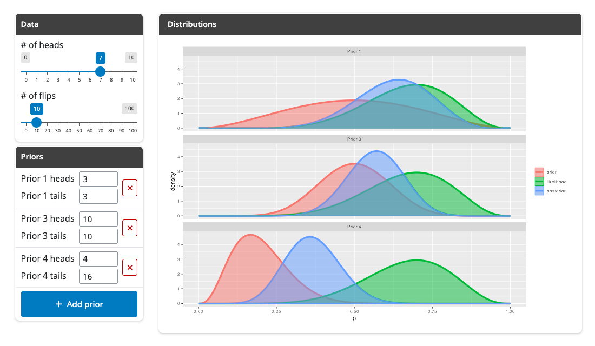

```{r setup}
#| message: false
#| warning: false
#| include: false
library(shiny)
library(bslib)

options(
  width = 80
)

knitr::opts_chunk$set(
  fig.align = "center", fig.retina = 2, dpi = 150,
  out.width = "100%"
)
```

# Dynamic UI

## Comparing priors

Our Beta-Binomial app has a single prior. To see how much the posterior depends on that choice we want to compare several priors, without knowing in advance how many there will be.

{fig-align="center" width="60%"}


## Prior, likelihood, & posterior

As before, the plot shows a prior, likelihood, and posterior curve, now once for each prior. A helper function computes all three, with the likelihood scaled so that it integrates to 1.

::: {.xsmall}
```{r}
#| eval: false
n_sim = 501

beta_binom = function(label, a, b, x, n) {
  tibble(
    label = label,
    p = (seq_len(n_sim) - 0.5) / n_sim,
    prior = dbeta(p, a, b),
    likelihood = dbinom(x, n, p) * (n + 1),
    posterior = dbeta(p, a + x, b + n - x)
  ) |>
    pivot_longer(
      prior:posterior,
      names_to = "distribution", 
      values_to = "density",
      names_transform = fct_inorder
    )
}
```
:::

::: {.aside}
This helper is slightly inefficient as it recalculates the same likelihood for every prior but that cost is small for the increased simplicity of the code.
:::

## Styling with CSS

The apps in this lecture share a small stylesheet that makes the inputs more compact. It is kept in its own file, [`Lec23_app.css`](notes/Lec23_app.css), and loaded by the UI.

::: {.xsmall}
```{r}
#| eval: false
ui = page_fillable(
  tags$head(includeCSS("Lec23_app.css")),
  ...
)
```

```css
.prior label { flex: 1; margin-bottom: 0; }
.prior input { width: 4.5rem; padding: 0.1rem 0.4rem; }
```
:::

::: {.medium}
* `includeCSS()` reads the file and returns its contents in a `<style>` tag. The path is relative to the app's directory.

* `tags$head()` moves that tag into the page's `<head>`, so it takes up no space in the layout.
:::


## Inputs for each prior

Each prior needs its own pair of inputs and every input needs its own id. A function that builds the ids from a number lets us make as many sets of inputs as we need.

::: {.xsmall}
```{r}
#| eval: false
prior_inputs = function(id) {
  card_body(
    numericInput(
      paste0("a_", id), paste("Prior", id, "heads"),
      min = 0, value = rpois(1, 3) + 1
    ),
    numericInput(
      paste0("b_", id), paste("Prior", id, "tails"),
      min = 0, value = rpois(1, 3) + 1
    )
  )
}
```
:::

`prior_inputs(2)` creates the inputs `a_2` and `b_2`. We will not know the number ahead of time, so we cannot write `input$a_2` instead we will perform look ups using something like `input[[paste0("a_", id)]]`.


## A first attempt with `renderUI()`

:::: {.columns}
::: {.column width='50%' .xsmall}
```{r}
#| eval: false
card(
  card_header("Priors"),
  uiOutput("priors"),
  card_footer(
    actionButton("add", "Add prior")
  )
)
```
:::

::: {.column width='50%' .xsmall}
```{r}
#| eval: false
output$priors = renderUI({
  map(
    seq_len(input$add), prior_inputs
  )
})
```
:::
::::

`input$add` counts clicks, so each click re-runs `renderUI()` and draws the inputs for priors `1` to `input$add`.


## Reading the inputs

The reactive builds each prior's ids and reads its inputs with `input[[...]]`. The `req()` waits for the inputs to arrive and requires both Beta shape parameters to be strictly positive. Fractional values are allowed.

::: {.xsmall}
```{r}
#| eval: false
d = reactive({
  map(
    seq_len(input$add),
    \(id) {
      a = input[[paste0("a_", id)]]
      b = input[[paste0("b_", id)]]
      req(a > 0, b > 0)

      beta_binom(paste("Prior", id), a, b, input$x, input$n)
    }
  ) |>
    list_rbind()
})
```
:::


## The complete app {.scrollable}

::: {.code-file .sourceCode .cell-code}
`r fontawesome::fa("file")` &nbsp; [`Lec23_app1.R`](notes/Lec23_app1.R)
:::
::: {.xsmall}
```{r app1}
#| file: notes/Lec23_app1.R
#| eval: false
#| code-line-numbers: "|22-34|48-57|72-74|76-88"
```
:::


## Limitations of `renderUI()`

The app runs, but it is frustrating to use.

* `renderUI()` rebuilds its whole output every time it runs.

  * This version regenerates every prior's starting values whenever another prior is added.

* The click count is the server's only record of what is on the page.

* This version can add priors, but cannot remove them.

What we need is a way to add or remove a single prior and leave the rest of the page alone.

# Example 2

## `reactiveVal()` & `reactiveValues()`

Inputs hold values received from the browser, and reactive expressions compute values. 

`reactiveVal()` and `reactiveValues()` hold state that server code can change directly.

:::: {.columns}
::: {.column width='50%' .xsmall}
```{r}
#| eval: false
count = reactiveVal(0)

count()
count(count() + 1)
```
:::

::: {.column width='50%' .xsmall}
```{r}
#| eval: false
rv = reactiveValues(count = 0)

rv$count
rv$count = rv$count + 1
```
:::
::::

::: {.medium}
* `reactiveVal()` holds a single value. Calling it with no arguments reads the value and calling it with an argument replaces it.

* `reactiveValues()` holds named values that are read and set with `$`. Unlike `input`, these values can be assigned directly.

* Both behave like inputs. A reactive or observer that reads one depends on it, and setting a new value invalidates everything that has read it.

* Change reactive state in an observer. Reactive expressions are lazy and outputs may be suspended while hidden, so a value set inside one may not change when we expect.
:::


## `insertUI()` & `removeUI()`

These functions add and remove pieces of UI from the server without touching anything else on the page.

::: {.xsmall}
```{r}
#| eval: false
insertUI(selector = "#priors", where = "beforeEnd", ui = prior_inputs(1))
```

```{r}
#| eval: false
removeUI(selector = "#prior_1")
```
:::

::: {.medium}
* `selector` is a CSS selector (like we used with `rvest`'s `html_elements()`).

* `where` places the new UI relative to the selected element.

  * `beforeBegin` puts it before the element.
  * `afterBegin` makes it the element's first child.
  * `beforeEnd` makes it the element's last child.
  * `afterEnd` puts it after the element.

* Both are side effects, so they belong in an observer.
:::


## Adding a prior

In the UI the `uiOutput()` is replaced by an empty `div` with the id `priors`.

:::: {.columns .xsmall}
::: {.column width='50%'}
```{r}
#| eval: false
card(
  card_header("Priors"),
  div(id = "priors"),
  card_footer(
    actionButton("add", "Add prior")
  )
)
```
:::

::: {.column width='50%'}
```{r}
#| eval: false
ids = reactiveVal(integer())

observe({
  id = input$add

  insertUI(
    "#priors", where = "beforeEnd",
    ui = prior_inputs(id)
  )
  ids(c(ids(), id))
}) |>
  bindEvent(input$add)
```
:::
::::

::: {.medium}
* The click count is different for every click, so it works as a unique id.

* `ids` is the server's only record of which priors are on the page.

* `bindEvent()` makes the observer depend only on `input$add` (and skip its initial value of zero).

  * Without it the observer would also depend on `ids()`.
:::


## Removing a prior

Each prior gets an id and a remove button.

::: {.xsmall}
```{r}
#| eval: false
card_body(
  id = paste0("prior_", id),
  ...,
  actionButton(paste0("remove_", id), NULL, icon = icon("xmark"))
)
```
:::

. . .

The remove button then needs an observer to make it functional. `once = TRUE` destroys the observer after it runs.

::: {.xsmall}
```{r}
#| eval: false
observe({
  removeUI(paste0("#prior_", id))
  ids(setdiff(ids(), id))
}) |>
  bindEvent(input[[paste0("remove_", id)]], once = TRUE)
```
:::

Anyone see an issue? Where do we define this? 


## Adding & removing together

Both steps need to occur in our `input$add` observer, which is the one place that knows the `id`.

::: {.xsmall}
```{r}
#| eval: false
ids = reactiveVal(integer())

observe({
  id = input$add

  insertUI("#priors", where = "beforeEnd", ui = prior_inputs(id))
  ids(c(ids(), id))

  observe({
    removeUI(paste0("#prior_", id))
    ids(setdiff(ids(), id))
  }) |>
    bindEvent(input[[paste0("remove_", id)]], once = TRUE)
}) |>
  bindEvent(input$add)
```
:::

::: {.medium}
* Every click creates a new inner observer with its own copy of `id`, so each remove button removes only its own prior.

* The remove button's input does not exist until its UI has been inserted. `bindEvent()` ignores it while it is `NULL`.
:::


## Updating the reactive

The reactive now iterates over `ids()` in place of `seq_len(input$add)`, so a removed prior also drops out of the plot.

::: {.xsmall}
```{r}
#| eval: false
d = reactive({
  map(
    ids(),
    \(id) {
      ...
    }
  ) |>
    list_rbind()
})
```
:::


## The complete app {.scrollable}

::: {.code-file .sourceCode .cell-code}
`r fontawesome::fa("file")` &nbsp; [`Lec23_app2.R`](notes/Lec23_app2.R)
:::
::: {.xsmall}
```{r app2}
#| file: notes/Lec23_app2.R
#| eval: false
#| code-line-numbers: "|24,34-37|55|77-91|95"

```
:::


## What we ended up with

The app works, but the code for a single prior is hard to follow and harder to reuse.

* The naming scheme (`prior_1`, `a_1`, `b_1`, `remove_1`) is repeated by hand in the UI function, both observers, and the reactive.

* The logic for one prior is spread over four separate places in the app.

* Every id lives in one shared namespace, so nothing stops another part of the app from also using `a_1`.

* Using these inputs in a second app means copying all of these pieces and keeping them in sync.


# Modules

## Shiny modules

A module is a pair of functions that together describe one piece of an app, such as the inputs for a single prior.

* The module UI function takes an `id` and returns UI, like `prior_inputs()` did.

* The module server function takes the same `id` and holds the server code for that UI.

* Everything inside the module is namespaced by the `id`. The module's code refers to `input$a`, while the rest of the app sees that input as `prior_1-a`.

A module can then be used several times in one app, each time with a different `id`, without any of the copies interfering with each other.


## `NS()`

Namespacing is nothing more than a prefix on the id. `NS()` returns a function that adds the prefix.

::: {.xsmall}
```{r ns}
ns = NS("prior_1")
```

```{r ns-use}
ns("a")
ns("remove")
```
:::

A module UI function wraps every input and output id in `ns()`. Leaving one out is the most common mistake with modules. The app still runs, but the module's server never sees that input.


## Module UI

By convention the function is named `*_ui()` and `id` is its first argument. Other arguments, like `label` here, are optional.

::: {.xsmall}
```{r}
#| eval: false
prior_ui = function(id, label) {
  ns = NS(id)

  card_body(
    id = ns("body"),
    numericInput(ns("a"), paste(label, "heads"), min = 0, value = rpois(1, 3) + 1),
    numericInput(ns("b"), paste(label, "tails"), min = 0, value = rpois(1, 3) + 1),
    actionButton(ns("remove"), NULL, icon = icon("xmark"))
  )
}
```
:::


## Module server

By convention the function is named `*_server()` and takes the same `id` as the UI function. The inner function is written just like an app's server function.

::: {.xsmall}
```{r}
#| eval: false
prior_server = function(id, label, x, n) {
  moduleServer(id, function(input, output, session) {
    reactive({
      req(input$a > 0, input$b > 0)

      beta_binom(label, input$a, input$b, x(), n())
    })
  })
}
```
:::

::: {.medium}
* The app's `input$x` is not visible here. Anything the module needs is passed in as a reactive and read as `x()`.

* `moduleServer()` returns the inner function's value, which can be anything. A module that only draws outputs returns nothing. One that computes values for the rest of the app returns a reactive, as here, or a list of reactives.
:::


## Using a module

Call each function once per copy, with matching ids.

::: {.xsmall}
```{r}
#| eval: false
ui = page_fillable(
  layout_columns(
    ..., # Existing Data card with x and n inputs
    card(
      card_header("Priors"),
      prior_ui("prior_1", "Prior 1"),
      prior_ui("prior_2", "Prior 2")
    ),
    plotOutput("plot")
  )
)

server = function(input, output, session) {
  x = reactive(input$x)
  n = reactive(input$n)
  prior_1 = prior_server("prior_1", "Prior 1", x, n)
  prior_2 = prior_server("prior_2", "Prior 2", x, n)

  d = reactive(bind_rows(prior_1(), prior_2()))
  ...
}
```
:::


## Modules & dynamic UI

A module server can be started at any time. Each click inserts a new copy of the UI and starts its server.

::: {.xsmall}
```{r}
#| eval: false
priors = reactiveVal(list())

observe({
  id = paste0("prior_", input$add)
  label = paste("Prior", input$add)

  insertUI("#priors", where = "beforeEnd", ui = prior_ui(id, label))
  prior = prior_server(id, label, x = reactive(input$x), n = reactive(input$n))
  priors(c(priors(), prior))
}) |>
  bindEvent(input$add)

d = reactive({
  map(priors(), \(prior) prior()) |>
    list_rbind()
})
```
:::

::: {.medium}
* `x` and `n` are wrapped in `reactive()` so the module sees the sliders' current values. Passing `input$x` would hand over only its value at the time of the click.
:::


## A module that removes itself

::: {.xsmall}
```{r}
#| eval: false
moduleServer(id, function(input, output, session) {
  removed = reactiveVal(FALSE)

  observe({
    removeUI(paste0("#", session$ns("body")))
    removed(TRUE)
  }) |>
    bindEvent(input$remove, once = TRUE)

  reactive({
    if (removed()) return(NULL)
    ...
  })
})
```
:::

::: {.medium}
* `input$remove` is namespaced for us but a CSS selector is not. `session$ns()` is the module's own `NS()` function, which gives the full id of the card body.

* Removing the UI does not stop the module's server. Here, its reactive remains in `priors()` and returns `NULL`, which `list_rbind()` drops.
:::


## The complete app {.scrollable}

::: {.code-file .sourceCode .cell-code}
`r fontawesome::fa("file")` &nbsp; [`Lec23_app3.R`](notes/Lec23_app3.R)
:::
::: {.xsmall}
```{r app3}
#| file: notes/Lec23_app3.R
#| eval: false
#| code-line-numbers: "|22-35|37-54|92-102|104-107"
```
:::


## Working with modules

::: {.medium}
* Name the pair `*_ui()` and `*_server()`, and keep the two functions together. Files in an app's `R/` folder are sourced automatically, so `R/prior.R` is a good home for them.

* Pass reactives into a module without calling them, as `x = reactive(input$x)` or `x = d`. Passing `input$x` hands over a single value that never updates.

* Return a reactive, or a list of reactives, for anything the rest of the app needs. Avoid reaching into a module's inputs from outside via `input[["prior_1-a"]]`.

* Modules can contain other modules. Inside a module the ids are relative, so a nested module is called with a plain id in the server and with `ns("id")` in the UI.

* A module server can be tested without a browser using `testServer()`.
:::


## Modules in the wild

Many packages ship their Shiny components as modules, so adding one to an app is a pair of function calls.

::: {.small}
| Package        | Module                                         | What it provides                                |
|----------------|------------------------------------------------|-------------------------------------------------|
| `esquisse`     | `esquisse_ui()`, `esquisse_server()`           | A drag and drop `ggplot2` builder               |
| `datamods`     | `import_ui()`, `import_server()`               | Importing data from a file, URL, or pasted text |
| `datamods`     | `filter_data_ui()`, `filter_data_server()`     | Interactive filtering of a data frame           |
| `shinyauthr`   | `loginUI()`, `loginServer()`                   | A login form and user authentication            |
| `shinyWidgets` | `selectizeGroupUI()`, `selectizeGroupServer()` | A group of linked select inputs                 |
:::


# Shiny for Python

## The same tools in Python

Everything in this lecture has a direct counterpart in Shiny for Python.

::: {.small}
| R                              | Python                                      |
|--------------------------------|---------------------------------------------|
| `uiOutput()`, `renderUI()`     | `ui.output_ui()`, `@render.ui`              |
| `insertUI()`, `removeUI()`     | `ui.insert_ui()`, `ui.remove_ui()`          |
| `reactiveVal()`                | `reactive.value()`                          |
| `observe()` with `bindEvent()` | `@reactive.effect` with `@reactive.event()` |
| `input[[id]]`                  | `input[id]()`                               |
| `NS()` in a UI function        | `@module.ui`                                |
| `moduleServer()`               | `@module.server`                            |
| `session$ns()`                 | `session.ns()`                              |
| `includeCSS()`                 | `ui.include_css()`                          |
:::

There is no `reactiveValues()`. Use several `reactive.value()` objects, or one that holds a dictionary.


## `reactive.value()`

A `reactive.value()` is read by calling it and replaced with its `set()` method.

::: {.xsmall}
```{python}
#| eval: false
priors = reactive.value([])

@reactive.effect
@reactive.event(input.add)
def _():
    id = f"prior_{input.add()}"
    label = f"Prior {input.add()}"

    ui.insert_ui(prior_ui(id, label), selector="#priors", where="beforeEnd")
    prior = prior_server(id, label, x=input.x, n=input.n)
    priors.set([*priors(), prior])
```
:::

::: {.medium}
* `set()` only invalidates when given a different object. Appending in place changes the list but does not invalidate its reactive dependents, so we build a new list.

* Both `ui.insert_ui()` and `ui.remove_ui()` use `selector` to identify an element. `ui.insert_ui()` also uses `where` to position the new UI relative to it.
:::


## Module UI & server

::: {.xsmall}
```{python}
#| eval: false
@module.ui
def prior_ui(label):
    return ui.card_body(
        ui.input_numeric("a", f"{label} heads", min=0, value=np.random.poisson(3) + 1),
        ui.input_numeric("b", f"{label} tails", min=0, value=np.random.poisson(3) + 1),
        ui.input_action_button("remove", "✕"),
        id=module.resolve_id("body"),
    )

@module.server
def prior_server(input, output, session, label, x, n):
    @reactive.calc
    def d():
        req(input.a(), input.b())
        req(input.a() > 0, input.b() > 0)
        return beta_binom(label, input.a(), input.b(), x(), n())

    return d
```
:::

::: {.medium}
* The decorators add `id` as the first argument of both functions and namespace the input and output ids for us.

* Any other id still has to be namespaced by hand, with `module.resolve_id()` in the UI and `session.ns()` in the server.

* An empty input is `None`, so the first `req()` guards the comparison.
:::


## The complete app {.scrollable}

::: {.code-file .sourceCode .cell-code}
`r fontawesome::fa("file")` &nbsp; [`Lec23_app.py`](notes/Lec23_app.py)
:::
::: {.xsmall}
```{python app-py}
#| file: notes/Lec23_app.py
#| eval: false
#| code-line-numbers: "|26-34|37-56|94-104|106-111"
```
:::


# Summary {visibility="uncounted"}

## Takeaways {visibility="uncounted"}

::: {.medium}
* `renderUI()` rebuilds its whole output, and the inputs in it keep their values only if we write code to restore them. `insertUI()` and `removeUI()` change one piece of the page and leave the rest alone.

* UI that is added while the app runs needs unique ids and a record on the server of what currently exists, typically kept in a `reactiveVal()`. Inputs with generated ids are read with `input[[id]]`.

* Doing this by pasting ids together works, but the naming scheme ends up repeated throughout the app.

* A module pairs a UI function with a server function that share an `id`. `NS()` prefixes the ids in the UI and `moduleServer()` gives the server a view of only its own inputs and outputs.

* Reactives go into a module as arguments and come out as its return value.

* Module servers can be started from an observer, which makes modules a good fit for UI that is created on demand.
:::


## Learning more {visibility="uncounted"}

::: {.medium}
- [Mastering Shiny - Dynamic UI](https://mastering-shiny.org/action-dynamic.html)
- [Mastering Shiny - Shiny modules](https://mastering-shiny.org/scaling-modules.html), with many more examples of module inputs and outputs
- [Modularizing Shiny app code](https://shiny.posit.co/r/articles/improve/modules/) from the Shiny documentation
- Reference pages for [`insertUI()`](https://shiny.posit.co/r/reference/shiny/latest/insertui.html), [`moduleServer()`](https://shiny.posit.co/r/reference/shiny/latest/moduleserver.html), and [`NS()`](https://shiny.posit.co/r/reference/shiny/latest/ns.html)
- [Mastering Shiny - Testing](https://mastering-shiny.org/scaling-testing.html) for `testServer()`
:::
