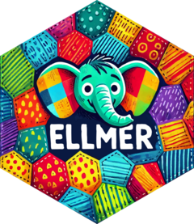
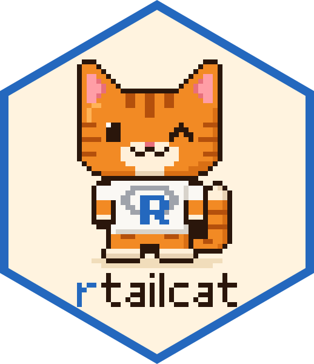

```{r setup}
#| message: false
#| warning: false
#| include: false
library(ellmer)

options(
  width = 80
)

knitr::opts_chunk$set(
  fig.align = "center", fig.retina = 2, dpi = 150,
  out.width = "100%"
)
```

# LLMs from R

## DukeGPT API

The examples today use Duke's API gateway, which gives every one at Duke a small daily allowance for a [range of commercial and open models](https://oit.duke.edu/help/articles/kb0038832/).

* Create an API key from the [AI Dashboard](https://dashboard.ai.duke.edu/)

* Save it as an environment variable named `DUKEGPT_API_KEY`, for example in your `~/.Renviron` file

* Setup instructions are at <https://github.com/DukeStatSci/dukegpt_codex_guide>

* Expect restrictive rate limits

Treat the key like a password. It should never appear in a script, a notebook, or a git repository.


# {#ellmer-logo data-menu-title="ellmer" .nostretch}

{fig-align="center" width="32%"}


## Available models {.scrollable}

The gateway can also list the models your key has access to. Any of these ids can be used as the `model` argument to `chat_openai()`.

::: {.xsmall}
```{r models_list}
#| cache: true
models = ellmer::models_openai(
  base_url = "https://litellm.oit.duke.edu/",
  credentials = function() Sys.getenv("DUKEGPT_API_KEY")
)
models$id
```
:::

::: {.aside}
The prices `models_openai()` reports come from `ellmer`'s own table of OpenAI prices, not the gateway. See the [OIT guide](https://oit.duke.edu/help/articles/kb0038832/) for Duke's costs.
:::


## A first chat {.wrap-output}

`ellmer` gives R a common interface to most LLM providers. A chat object holds a connection to one model along with the conversation so far.

::: {.xsmall}
```{r}
library(ellmer)

duke_chat = function(...) {
  chat_openai(
    ...,
    base_url = "https://litellm.oit.duke.edu/",
    credentials = function() Sys.getenv("DUKEGPT_API_KEY"),
    model = "gpt-5.4-mini",
    api_args = list(cache = list(`no-cache` = TRUE))
  )
}
```
:::

::: {.xsmall}
```{r chat_hello}
#| cache: true
chat = duke_chat()
chat$chat("Hello, who are you?")
```
:::

::: {.aside}
The DukeGPT API runs on LiteLLM, which follows OpenAI's API specification, hence `chat_openai()`. The gateway also caches replies to identical requests, which `no-cache` turns off.
:::


## A chat is a list of turns {.wrap-output}

The model itself remembers nothing between requests. Each call to `$chat()` sends the whole conversation again, and the chat object is what keeps track of it.

::: {.xsmall}
```{r chat_recall}
#| cache: true
chat$chat("What was the first thing I said to you?")
```
:::

::: {.xsmall}
```{r}
length(chat$get_turns())
```
:::

Everything the model knows about our task has to be in that list of turns. This is usually called the model's context.

::: {.aside}
Resending the conversation costs less than it sounds. Providers cache the start of a recent request, and these cached input tokens are billed at a fraction of the usual rate.
:::


## LLMs are stochastic and have limitations {.wrap-output}

::: {.xsmall}
```{r}
q = "How many a's are in abracadabra alakazam? Reply with just a number."
```
:::

:::: {.columns .xsmall}
::: {.column width='33%'}
```{r count1}
#| cache: true
duke_chat()$chat(q)
```
:::
::: {.column width='33%'}
```{r count2}
#| cache: true
duke_chat()$chat(q)
```
:::
::: {.column width='33%'}
```{r count3}
#| cache: true
duke_chat()$chat(q)
```
:::
::::

::: {.xsmall}
```{r}
stringr::str_count("abracadabra alakazam", "a")
```
:::

Each call is a fresh draw, so the answers can change from one run to the next, and nothing in a reply tells us whether it is right.


## Answer shaped objects {.wrap-output}

::: {.xsmall}
```{r}
x = 123456789
y = 12345678
q = interpolate("What is {{x}} * {{y}}? Digits only.")
```
:::

:::: {.columns .xsmall}
::: {.column width='33%'}
```{r mult1}
#| cache: true
r1 = duke_chat()$chat(q)
```
:::
::: {.column width='33%'}
```{r mult2}
#| cache: true
r2 = duke_chat()$chat(q)
```
:::
::: {.column width='33%'}
```{r mult3}
#| cache: true
r3 = duke_chat()$chat(q)
```
:::
::::

::: {.xsmall}
```{r}
(truth = format(x * y, scientific = FALSE))
```
:::

. . .

```{r}
#| echo: false
d = c(truth = truth, r1 = r1, r2 = r2, r3 = r3) |>
  strsplit("") |>
  do.call(what = rbind)

wrong = sweep(d, 2, d["truth", ], "!=")
d[wrong] = paste0("<span style='color: red;'>", d[wrong], "</span>")

knitr::kable(
  d, format = "html", escape = FALSE, align = "c",
  table.attr = "style='width: auto; margin: 0.5em auto; font-family: monospace;'"
)
```

::: {.aside}
We have purposely picked a smaller, more limited model to demonstrate these failings. Larger models are (much) less likely to make them.
:::


## Hadley's "conclusions"

From Hadley Wickham's [A no bullshit guide to LLMs](https://www.youtube.com/watch?v=ctc2kx3LxG8&t=18m17s)

. . .

> So LLMs kind of suck
>
> * The results are stochastic
> * The models are constantly changing
> * The difference between good results and bad results can be razor thin
> * They almost always give plausible results
> * They rarely admit doubt or lack of knowledge

. . .

The LLM corollary of Box's aphorism is that all models are wrong, but some are useful. The rest of today is about what makes them useful.


# Prompts

## System prompts

A system prompt is text placed ahead of the conversation that tells the model who it is and how to behave. The user never has to repeat it, and it shapes every reply.

::: {.xsmall}
```{r}
quiz_prompt = paste(
  "You are a statistics professor helping students prepare for a quiz on Shiny.",
  "Ask one short conceptual question at a time and wait for the answer.",
  "Give brief feedback after each answer and keep track of the score.",
  "After five questions report the score and the topics to review."
)
```
:::

::: {.xsmall}
```{r}
#| eval: false
quiz = duke_chat(system_prompt = quiz_prompt)
live_browser(quiz)
```
:::

::: {.aside}
`live_browser()` opens a chat window built with `shinychat`.
:::


## Same model, different prompt {.wrap-output .scrollable}

::: {.mxsmall}
```{r}
q = "What is a p-value?"
```
:::

:::: {.columns .mxsmall}
::: {.column width='50%'}
```{r prompt_terse}
#| cache: true
terse = duke_chat(
  system_prompt = "Answer in one sentence."
)
terse$chat(q)
```
:::
::: {.column width='50%'}
```{r prompt_pirate}
#| cache: true
pirate = duke_chat(
  system_prompt = "Answer as a pirate."
)
pirate$chat(q)
```
:::
::::


# Tool usage

## tool = function + description

A tool is an R function that we describe to the model. The model cannot run anything, but it can ask us to call the function and send back the result.

:::: {.columns .xsmall}
::: {.column width='50%'}
```{r}
multiply = tool(
  function(x, y) {
    z = as.numeric(x) * as.numeric(y)
    format(z, scientific = FALSE)
  },
  name = "multiply",
  description = "Multiply two numbers",
  arguments = list(
    x = type_number("First number"),
    y = type_number("Second number")
  )
)
```
:::
::: {.column width='50%' .fragment}
```{r mult_tool}
#| cache: true
calc = duke_chat()
calc$register_tool(multiply)

calc$chat( interpolate(
  "What is {{x}} * {{y}}? Digits only."
) )
```

```{r}
format(x * y, scientific = FALSE)
```
:::
::::


## What happened?

Printing the chat shows every turn. The model replied to our question with a request to call `multiply()`, `ellmer` ran the function and sent the result back, and only then did the model write its answer.

The code that sits between the model and the world, running the tools it asks for and passing back the results, is called a harness. Here `ellmer` is the harness. In Claude Code, Codex, or Antigravity the app itself plays the same role, with tools that read files and run commands.

::: {.xsmall}
```{r}
calc
```
:::


# Agents

## agent = tools + prompt

Give a model tools that let it look at and change the world around it, and a prompt that says what it is for, then let it keep calling tools until the task is done. 

| Piece  | What it provides                                               |
|--------|----------------------------------------------------------------|
| Model  | Reads the context and chooses the next step                    |
| Tools  | The only ways the model can observe or act                     |
| Prompt | The goal, the rules, and what the model should know in advance |
| Loop   | Runs the requested tools and feeds the results back            |

: {tbl-colwidths="[18,82]"}

We can build a small one in a few lines of `ellmer`.


## Tools for reading and writing

Our agent will work with the files in the website's `notes/` directory. Each tool uses `basename()` so that the model cannot reach files anywhere else.

::: {.xsmall}
```{r}
root = "notes"
```
:::

:::: {.columns .xsmall}
::: {.column width='50%'}
```{r}
list_files = tool(
  function() dir(root),
  name = "list_files",
  description = "List the project's files."
)

read_file = tool(
  function(file) {
    path = file.path(root, basename(file))
    readr::read_file(path)
  },
  name = "read_file",
  description = "Read one project file.",
  arguments = list(
    file = type_string("File name")
  )
)
```
:::
::: {.column width='50%'}
```{r}
write_file = tool(
  function(file, content) {
    path = file.path(root, basename(file))
    readr::write_file(content, path)
    paste("Wrote", path)
  },
  name = "write_file",
  description = "Write a project file.",
  arguments = list(
    file = type_string("File name"),
    content = type_string("Text to write")
  )
)
```
:::
::::


## Adding the prompt

::: {.xsmall}
```{r}
agent_prompt = paste(
  "You are an assistant working in a directory of course materials.",
  "Use list_files and read_file to look at the files before you answer.",
  "Never guess at what a file contains, and read only the files you need.",
  "Write a file only when you are asked to.",
  "Finish by listing the files you read and the files you wrote."
)
```
:::

::: {.xsmall}
```{r}
agent = duke_chat(system_prompt = agent_prompt)
agent$register_tools(list(list_files, read_file, write_file))
```
:::

The prompt carries the things we would otherwise repeat in every request, such as how to approach the work, what not to do, and how to report back.

::: {.aside}
Just because we told a model to do something does not mean it will always listen.
:::


## Running the agent {.wrap-output .scrollable}

::: {.mxsmall}
```{r agent_run}
#| cache: true
agent$chat(
  "Find the R Shiny apps for Lecture 23. Write a short summary of what each one",
  "does, and how each differs from the one before it, to Lec23_shiny_apps.md."
)
```
:::


## What the agent wrote {.scrollable}

::: {.code-file .sourceCode .cell-code}
`r fontawesome::fa("file")` &nbsp; [`Lec23_shiny_apps.md`](notes/Lec23_shiny_apps.md)
:::
::: {.xsmall .wrap-code}
```{embed}
#| file: notes/Lec23_shiny_apps.md
```
:::


## Same tools, different prompt {.wrap-output .scrollable}

A second agent gets the two reading tools and a new prompt. Without `write_file` it has no way to change anything.

::: {.mxsmall}
```{r}
review_prompt = paste(
  "You are reviewing R code written by students in a statistical programming course.",
  "Read the file you are asked about before commenting on it.",
  "Report at most three problems, most serious first, each with its line number.",
  "If the code is fine, say so. Do not rewrite the code."
)
```
:::

::: {.mxsmall}
```{r reviewer_run}
#| cache: true
reviewer = duke_chat(system_prompt = review_prompt)
reviewer$register_tools(list(list_files, read_file))

reviewer$chat("Review Lec23_app1.R")
```
:::


## Coding agents

Tools like Claude Code, Codex, and Positron Assistant are the same four pieces at a larger scale.

::: {.medium}
| Piece  | In a coding agent                                                               |
|--------|---------------------------------------------------------------------------------|
| Model  | A current frontier model                                                        |
| Tools  | Read, search, and edit files, run shell commands, fetch web pages               |
| Prompt | A long system prompt, plus your project's instructions (`CLAUDE.md`, `AGENTS.md`) |
| Loop   | Runs until the task is done or the agent needs something from you               |

: {tbl-colwidths="[15,85]"}
:::

The parts we can extend have names. The Model Context Protocol (MCP) is a standard way to package tools as a server that any agent can connect to, for example for GitHub, a database, or a running R session. A skill is a prompt, kept in a file, that the agent loads only when a task calls for it.


# {#rtailcat-logo data-menu-title="rtailcat" .nostretch}

::: {.center .msgiant}
Adventures in vibe coding with
:::

{fig-align="center" width="32%"}


## A project built with agents

[`rtailcat`](https://rundel.github.io/rtailcat/) is an R package that embeds [tailcat](https://github.com/tailscale/tailcat), a Go library from Tailscale for opening encrypted connections between two machines without accounts, port forwarding, or a VPN.

:::: {.columns .xsmall}
::: {.column width='50%'}
```{r}
#| eval: false
library(rtailcat)

srv = TailcatServer$new()
lst = srv$listen(8080)
tailcat_reveal(srv$address)
#> [1] "tcoWFwWCAAAQIAAAAAAAAAA..."

conn = lst$accept()
msg = conn$read_all(as = "text")
conn$write(paste("server received:", msg))
conn$close_write()
```
:::
::: {.column width='50%'}
```{r}
#| eval: false
library(rtailcat)

cl = TailcatClient$new("tcoWFwWCAAAQIAAAAAAAAAA...")

conn = cl$dial(8080)
conn$write("hello")
conn$close_write()
conn$read_all(as = "text")
#> [1] "server received: hello"
```
:::
::::

It went from an empty directory to a tested, documented package in nine days, with coding agents writing nearly all of the code.


## What is in the package

::: {.medium}
* Three layers, each a different language. Go for the upstream library, C++ for the wrapper, and R for the R6 user interface.

* About 3,300 lines of R, 1,200 lines of C++, and 160 tests

* A vignette, a `pkgdown` site, and CI on macOS, Linux, and Windows

* 15 commits between November 11 and November 19
:::

Writing the code was the fast part. The rest of this section is about what had to be in place for the result to be something worth sharing*.

::: {.aside}
Sharing here means putting on GitHub, not publishing to CRAN.
:::


## Write down what the agent should know

An agent starts every session with an empty context. The project's instruction file is the prompt that gets it back up to speed, and it is worth as much care as the code. Claude Code reads `CLAUDE.md`, while Codex and many other agents read `AGENTS.md`, a convention shared across tools. A few lines from `rtailcat`'s [`CLAUDE.md`](https://github.com/rundel/rtailcat/blob/main/CLAUDE.md) are below.

::: {.small}
> * `R/cpp11.R` and `src/cpp11.cpp` are generated by `cpp11::cpp_register()`; never edit them by hand.
> * Every blocking R6 method `foo()` has a `foo_async()` twin returning a promise. Timeouts are in seconds, `Inf` means no deadline, and `0` polls.
> * Nothing about a handle is cached in R (owner's decision).
> * The Windows build passes in CI; whether the export list is in fact limited has not been inspected.
:::

The file records the architecture, the conventions, the commands to run, the decisions that are mine and not up for debate, and what has not been checked. Claude wrote most of it, adding to it as we iterated on the project, and my job was to review it and correct it.


## Give the agent a way to check its work

An agent's tool results are only useful if they tell it something true. For a package that means a test suite the agent can run itself, and `rtailcat` has two kinds of tests.

* About 120 tests the agent wrote for the R interface as it built it.

* About 40 tests it was asked to port from tailcat's own Go test suite, so the R package is checked against upstream's expectations and not just the agent's.

::: {.xsmall}
```{r}
#| eval: false
test_that("tailcat_address_parse() decodes upstream's reference addresses", {
  # from tailcat_test.go: TestAddr (just_key, region_id)
  just_key = "tcoWFwWCAAAQIAAAAAAAAAAAAAAAAAAAAAAAAAAAAAAAAAAAAAHw"
  expect_identical(tc_address(list(p = test_key())), just_key)
  ...
})
```
:::

::: {.aside}
A formatter, a linter, and `R CMD check` in CI round this out, so style and packaging problems surface without anyone having to look for them.
:::


## What stays with you

* Design decisions. The agent will propose an API, but what the package should do, and what it should refuse to do, is your call.

* Review. Read the diff before every commit, and keep commits small enough that this is possible.

* Skepticism. "All tests pass" is a claim, so look at the output. Ask what was not tested and what the actual tests test.

* Responsibility. Your name is on the repo/commits, so the bugs are yours as well.


# Being a good citizen

## Other people's time

Very little of what an agent does stays on your machine. `rtailcat` builds on Tailscale's code, uses their public relay servers, and reports bugs to their issue tracker.

* Agents make it cheap to produce code, issues, pull requests, and web requests. Reading and serving them costs other people just as much as it always did.

* An agent will happily run a test suite against a public server hundreds of times a day, or open an issue for something it (or you) only half understand.

* Whatever is sent under your account is yours, whoever wrote it.

`rtailcat`'s tests start a relay server on the local machine, so running them thousands of times puts no load on anyone else's infrastructure.


## Finding a bug that is not yours

While writing tests for UDP connections the agent found that a zero byte read failed, and that the datagram that was waiting disappeared.

::: {.xsmall}
```{r}
#| eval: false
cc$write("dropped")
cc$write("kept")
```
:::

::: {.xsmall}
```{r}
#| eval: false
sc$read(n = 0, timeout = 5)
#> Error in `sc$read()`:
#> ! Could not read.
#> ℹ tailcat: read udp [fd7a:115c:a1e0:...]:9000: bad buffer

rawToChar(sc$read(timeout = 5))
#> [1] "kept"
```
:::

The error text comes from tailcat and not from our code, which suggests the problem is upstream. That is a hypothesis, and it needs checking before anyone else hears about it.


## Before reporting

* Check the existing issues, open and closed. If someone has already reported it, add your reproduction there instead of opening a duplicate.

* Reproduce it without your own code. This is the same idea as a [reprex](https://reprex.tidyverse.org/), a minimal example that anyone can run. The report for this bug is a short Go test that runs inside tailcat's own test suite, with no R involved.

* Check the current version. A bug in the commit you pinned last week may already be fixed.

* Read what the documentation promises. Here the C header defined a zero byte read for TCP and said nothing for UDP.

* Read the project's contributing guide, including any policy on AI assisted contributions.

This is tedious work that agents are good at. You still have to run the reproduction yourself and confirm it shows what the report says it shows.


## The agent drafts, you post

The agent wrote a draft of each issue to a file in the project's notes directory. What was posted as [#163](https://github.com/tailscale/tailcat/issues/163) and [#187](https://github.com/tailscale/tailcat/issues/187) is shorter than either draft.

::: {.medium}
| In the draft                                              | In the posted issue             |
|-----------------------------------------------------------|---------------------------------|
| The problem, in one paragraph                             | Kept                            |
| A reproduction that runs in upstream's test suite         | Kept                            |
| Observed and expected behavior, with the docs quoted      | Kept, with fewer options listed |
| A "likely cause" section naming a line in their code      | Cut                             |
| A related problem that could not be reproduced            | Cut                             |
| The agent's wording ("half-close")                        | Changed to upstream's terms     |

: {tbl-colwidths="[62,38]"}
:::

The maintainers know their code better than we do. A report should give them what they cannot get without us, which is a clear statement of the problem and a way to see it.


## Things worth checking on

Filing the issue is not the end of the job, and neither is a passing test run.

::: {.medium}
* Your open issues. Answer questions from the maintainers promptly, confirm that a fix works for you, and say thank you.

* Your dependencies. Know which versions you rely on, and look at what changed when you update them.

* Your CI. Read the logs now and then, since a check can pass with warnings that were not there last month.

* Your agent's claims. "Fixed", "verified", and "no other callers" are all statements you can test.
:::


# Summary {visibility="uncounted"}

## Takeaways {visibility="uncounted"}

::: {.medium}
* A chat is a list of turns that is sent to the model in full on every request. The model knows only what is in that context.

* A tool is a function plus a description. The model asks for a call, our code runs it, and the result goes back into the conversation.

* An agent is a model with tools, a prompt, and a loop. The tools set what it can do and the prompt sets how it goes about it.

* Coding agents work best in projects with written instructions, tests they can run, and a person who reads what they produce.

* Agents make output cheap, but other people's attention costs what it always did. Verify before you report, keep reports short, post them yourself, and follow up.
:::


## Learning more {visibility="uncounted"}

::: {.medium}
- Hadley Wickham's [A no bullshit guide to LLMs](https://www.youtube.com/watch?v=ctc2kx3LxG8&t=18m17s)
- [Getting started with ellmer](https://ellmer.tidyverse.org/articles/ellmer.html) and its articles on [tool calling](https://ellmer.tidyverse.org/articles/tool-calling.html) and [prompt design](https://ellmer.tidyverse.org/articles/prompt-design.html)
- [`chatlas`](https://posit-dev.github.io/chatlas/), the Python counterpart to `ellmer` with the same chat and tool interface
- The [Model Context Protocol](https://modelcontextprotocol.io/) documentation
- The [`rtailcat` repository](https://github.com/rundel/rtailcat), including its `CLAUDE.md`, and the two upstream issues, [#163](https://github.com/tailscale/tailcat/issues/163) and [#187](https://github.com/tailscale/tailcat/issues/187)
:::
