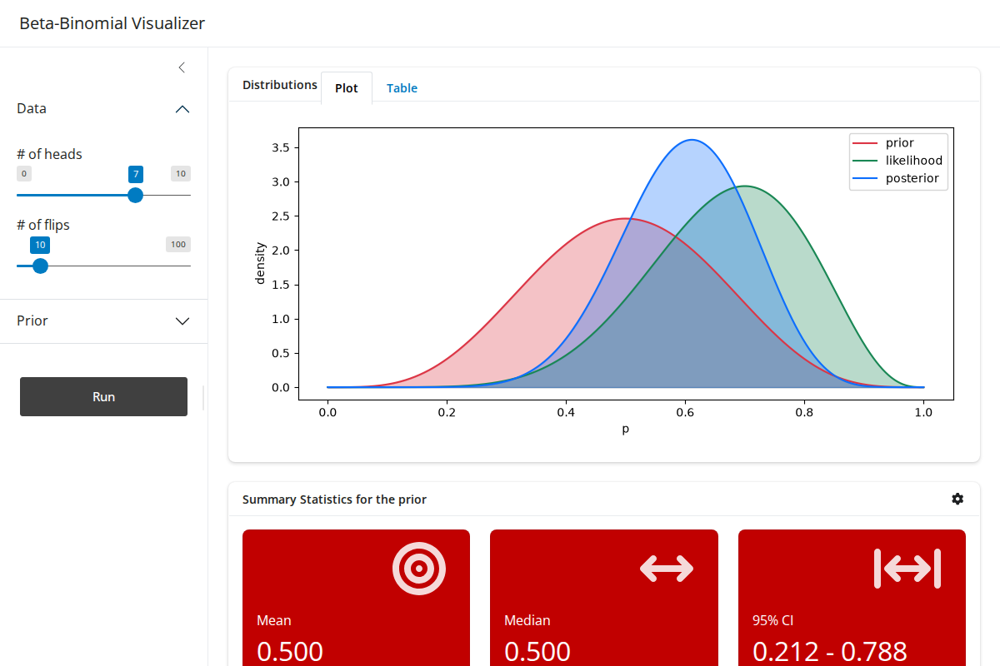

# {#shiny-logo data-menu-title="shiny" .nostretch}

```{r setup}
#| message: false
#| warning: false
#| include: false
options(
  width = 80
)

knitr::opts_chunk$set(
  fig.align = "center", fig.retina = 2, dpi = 150,
  out.width = "100%"
)

# Python must be initialized while the working directory still holds .venv
reticulate::use_virtualenv(normalizePath(".venv"), required = TRUE)
```

{fig-align="center" width="32%"}


## Shiny for Python

Shiny is also available as a Python package, also called `shiny`. It is a separate implementation written in Python and not a wrapper around the R package, so no R installation is involved.

Almost everything from the last two lectures carries over.

* The same split between a UI and a server function

* The same reactive model with inputs, outputs, reactive expressions, and observers

* The same browser side code, so apps look and behave the same

* The `bslib` components (cards, value boxes, sidebars, layouts) are built in

What changes is the syntax, and most of today is about mapping what we already know from R onto Python.


## Getting started

Add the package to a project with `uv`, then write the app in a file named `app.py`.

::: {.small}
```bash
uv add shiny
```
:::

An app is started from the terminal. With `--reload` the app restarts every time the file is saved.

::: {.small}
```bash
uv run shiny run --reload app.py
```
:::

Positron and VS Code have a Shiny extension that adds a run button and shows the app in a viewer pane, much like RStudio does for R.


## Core and Express

Shiny for Python has two syntaxes for writing an app.

::: {.medium}
* Shiny Express mixes UI and server code together in one script. It is compact and reads like a notebook, which makes it nice for small apps.

* Shiny Core keeps a UI object and a server function separate, just like R.
:::

We will use Core throughout. It maps directly onto the R apps we have written, and what you learn transfers to Express easily.

::: {.aside}
The Shiny documentation shows both. Look for the Express / Core toggle at the top of each page.
:::


# Some Python syntax

## Functions inside functions

A function can be defined inside another function. The inner function can use the variables of the outer one, including its arguments.

::: {.small}
```{python}
def make_power(k):
    def power(x):
        return x**k
    return power
```

```{python}
square = make_power(2)
square(4)
```
:::

A Shiny server function works the same way. Every output and reactive is a function defined inside `server()`, which is how they can all see `input`.


## Decorators

A decorator is a function that takes a function and returns something to use in its place, usually another function.

::: {.small}
```{python}
def shout(f):
    def wrapper(name):
        return f(name).upper()
    return wrapper
```
:::

:::: {.columns .small}
::: {.column width='50%'}
```{python}
def greet(name):
    return f"Hello, {name}!"

greet = shout(greet)
greet("Colin")
```
:::

::: {.column width='50%'}
```{python}
@shout
def greet(name):
    return f"Hello, {name}!"

greet("Colin")
```
:::
::::

The `@` line is shorthand for the reassignment on the left. The function is defined, passed to `shout()`, and the result is bound to the name `greet`.


## Decorators that register

A decorator does not have to change the function at all. It can simply record it somewhere, and it can see the function's name while doing so.

::: {.small}
```{python}
outputs = {}

def render(f):
    outputs[f.__name__] = f
    return f
```

```{python}
@render
def plot():
    return "a plot"

@render
def table():
    return "a table"
```

```{python}
list(outputs)
outputs["plot"]()
```
:::

This is roughly what Shiny does. The name of a decorated function is the id of the output it fills.


## Arguments and stacking

A decorator can take arguments. In that case the call after the `@` runs first and returns the actual decorator.

::: {.small}
```{python}
def repeat(n):
    def decorator(f):
        def wrapper(name):
            return [f(name) for _ in range(n)]
        return wrapper
    return decorator
```

```{python}
@repeat(2)
@shout
def greet(name):
    return f"Hello, {name}!"

greet("Colin")
```
:::

Stacked decorators are applied from the bottom up, so this is `repeat(2)(shout(greet))`. The order matters, and we will see a case in Shiny where getting it wrong is an error.


## Positional and keyword arguments

In a Python call all positional arguments must come before any keyword arguments. UI functions take their children as positional arguments, so the named options that R code often puts first have to move to the end.

:::: {.columns .small}
::: {.column width='50%'}
```r
card(
  full_screen = TRUE,
  card_header("Plot"),
  plotOutput("plot")
)
```
:::

::: {.column width='50%'}
```python
ui.card(
    ui.card_header("Plot"),
    ui.output_plot("plot"),
    full_screen=True,
)
```
:::
::::

A list of components is unpacked into positional arguments with `*`, which does the job of `!!!` in R.

:::: {.columns .small}
::: {.column width='50%'}
```r
layout_column_wrap(!!!boxes)
```
:::

::: {.column width='50%'}
```python
ui.layout_column_wrap(*boxes)
```
:::
::::


# From R to Python

## Anatomy of an app

:::: {.columns .small}
::: {.column width='50%'}
```r
library(shiny)
library(bslib)

ui = page_fluid()

server = function(input, output, session) {

}

shinyApp(ui = ui, server = server)
```
:::

::: {.column width='50%'}
```python
from shiny import App, reactive, render, ui


app_ui = ui.page_fluid()

def server(input, output, session):
    ...


app = App(app_ui, server)
```
:::
::::

::: {.medium}
* Everything comes from four names. `ui` holds the UI functions, `render` the output renderers, `reactive` the reactive tools, and `App` ties the pieces together.
* The UI object is called `app_ui` because the name `ui` is already taken by the module.
* The app object must be named `app`, which is what `shiny run` looks for.
:::


## UI function names

Every UI function lives in `ui` and uses `snake_case`. Inputs start with `input_` and outputs start with `output_`, instead of ending in `Input` and `Output`.

::: {.small}
| R                                | Python                                |
|----------------------------------|---------------------------------------|
| `sliderInput()`                  | `ui.input_slider()`                   |
| `numericInput()`                 | `ui.input_numeric()`                  |
| `selectInput()`                  | `ui.input_select()`                   |
| `actionButton()`                 | `ui.input_action_button()`            |
| `plotOutput()`                   | `ui.output_plot()`                    |
| `textOutput()`                   | `ui.output_text()`                    |
| `uiOutput()`                     | `ui.output_ui()`                      |
| `h4()`, `p()`, `div()`           | `ui.h4()`, `ui.p()`, `ui.div()`       |
| `page_sidebar()`, `sidebar()`    | `ui.page_sidebar()`, `ui.sidebar()`   |
| `card()`, `value_box()`          | `ui.card()`, `ui.value_box()`         |
:::

The `bslib` functions keep their names, since they were already in `snake_case`.


## Translating a UI

:::: {.columns .xsmall}
::: {.column width='50%'}
```r
ui = page_sidebar(
  title = "Beta-Binomial Visualizer",
  sidebar = sidebar(
    h4("Data:"),
    sliderInput(
      "x", "# of heads",
      min = 0, max = 100, value = 7
    ),
    sliderInput(
      "n", "# of flips",
      min = 0, max = 100, value = 10
    )
  ),
  card(
    class = "p-2",
    plotOutput("plot")
  )
)
```
:::

::: {.column width='50%'}
```python
app_ui = ui.page_sidebar(
    ui.sidebar(
        ui.h4("Data:"),
        ui.input_slider(
            "x", "# of heads",
            min=0, max=100, value=7,
        ),
        ui.input_slider(
            "n", "# of flips",
            min=0, max=100, value=10,
        ),
    ),
    ui.card(
        ui.output_plot("plot"),
        class_="p-2",
    ),
    title="Beta-Binomial Visualizer",
)
```
:::
::::

::: {.medium}
* The sidebar is the first positional argument of `ui.page_sidebar()` and `title` moves to the end.
* `class` is a reserved word in Python, so the argument is spelled `class_`.
* `TRUE`, `FALSE`, and `NULL` become `True`, `False`, and `None`.
:::


## Reading inputs

In R an input is read as `input$x`. In Python it is `input.x()`, with parentheses.

:::: {.columns .small}
::: {.column width='50%'}
```r
input$n - input$x
```
:::

::: {.column width='50%'}
```python
input.n() - input.x()
```
:::
::::

Python is being more explicit here. Every reactive value is an object, and calling it both returns the current value and records the dependency. This is the same convention R already uses for reactive expressions such as `d()`.

Leaving off the parentheses is the most common mistake when coming from R. The result is the reactive object and not its value, which usually leads to a confusing type error somewhere later.

::: {.small}
```python
input.n - input.x
#> TypeError: unsupported operand type(s) for -: 'Value' and 'Value'
```
:::


## Outputs

:::: {.columns .small}
::: {.column width='50%'}
```r
output$summary_title = renderText({
  paste(
    "Summary Statistics for the",
    input$summary_dist
  )
})
```
:::

::: {.column width='50%'}
```python
@render.text
def summary_title():
    return (
        "Summary Statistics for the "
        + input.summary_dist()
    )
```
:::
::::

::: {.medium}
* A `render*()` function wrapped around a block of code becomes a `@render` decorator on a function with no arguments.
* There is no assignment to `output`. The function name is the output id, so `summary_title()` fills `ui.output_text("summary_title")`.
* The value needs an explicit `return`. An R block returns its last expression, while a Python function without a `return` gives `None` and an empty output.
:::


## Plots and tables

`@render.plot` works with `matplotlib` and anything built on it, such as `seaborn`, `pandas` plotting, and `plotnine`. Return the figure, or just draw with `pyplot` and return nothing.

::: {.small}
```python
@render.plot
def plot():
    fig, ax = plt.subplots()
    for dist, df in d().groupby("distribution", sort=False):
        ax.plot(df["p"], df["density"], label=dist)
        ax.fill_between(df["p"], df["density"], alpha=0.3)
    ax.legend()
    return fig
```
:::

For tables the usual choice is `@render.data_frame` with `ui.output_data_frame()`, which shows a `pandas` or `polars` data frame as a scrollable, sortable grid.

::: {.small}
```python
@render.data_frame
def table():
    return d()
```
:::

::: {.aside}
`@render.table` is the direct equivalent of `renderTable()` and gives a plain HTML table. It needs the `jinja2` package to be installed.
:::


## Reactive expressions

:::: {.columns .xsmall}
::: {.column width='50%'}
```r
d = reactive({
  tibble(
    p = seq(0, 1, length.out = 1001),
    prior = dbeta(p, input$a, input$b)
  )
})
```
:::

::: {.column width='50%'}
```python
@reactive.calc
def d():
    p = np.linspace(0, 1, 1001)
    return pd.DataFrame({
        "p": p,
        "prior": stats.beta.pdf(
            p, input.a(), input.b()
        ),
    })
```
:::
::::

`reactive()` becomes the `@reactive.calc` decorator. The result is used the same way in both languages, by calling `d()` from an output or another reactive.

Nothing about the behavior changes. A calc is lazy, it caches its value, and it is invalidated when any input it read changes. The reactive graph from Lecture 20 describes the Python app just as well.


## Observers

:::: {.columns .small}
::: {.column width='50%'}
```r
observe({
  updateSliderInput(
    session, "x", max = input$n
  )
})
```
:::

::: {.column width='50%'}
```python
@reactive.effect
def _():
    ui.update_slider(
        "x", max=input.n()
    )
```
:::
::::

::: {.medium}
* `observe()` becomes `@reactive.effect`. The name reflects what an observer is for, which is running code for its side effects.
* An effect is never called by name, so by convention the function is named `_`. Reusing `_` for several effects is fine. Calcs and outputs need unique names.
* The `update*()` functions are in `ui` as `ui.update_slider()`, `ui.update_numeric()`, and so on. They find the current session on their own, so `session` is not passed.
:::


## Events

`bindEvent()` becomes the `@reactive.event()` decorator, which takes the reactive values to listen to.

:::: {.columns .small}
::: {.column width='50%'}
```r
d = reactive({
  ...
}) |>
  bindEvent(input$run)
```
:::

::: {.column width='50%'}
```python
@reactive.calc
@reactive.event(input.run)
def d():
    ...
```
:::
::::

::: {.medium}
* The event is passed as `input.run` without parentheses. We are handing over the reactive object to watch, not reading its current value.
* `@reactive.event()` goes directly above the `def`, underneath `@reactive.calc`, `@reactive.effect`, or `@render.*`. Decorators apply from the bottom up, so the event wraps the function first. The other order is an error.
* `ignoreNULL` and `ignoreInit` become `ignore_none` and `ignore_init`.
:::


## Dynamic UI

`renderUI()` becomes `@render.ui`, paired with `ui.output_ui()`. A list comprehension takes the place of `map()`, and `*` the place of `!!!`.

:::: {.columns .xsmall}
::: {.column width='50%'}
```r
output$boxes = renderUI({
  boxes = map(
    input$dists,
    \(dist) value_box(
      title = dist,
      value = post_mode(dist)
    )
  )

  layout_column_wrap(
    width = "200px", !!!boxes
  )
})
```
:::

::: {.column width='50%'}
```python
@render.ui
def boxes():
    boxes = [
        ui.value_box(
            dist,
            post_mode(dist),
        )
        for dist in input.dists()
    ]

    return ui.layout_column_wrap(
        *boxes, width="200px"
    )
```
:::
::::

The `bsicons` package has no Python version. The `faicons` package fills the same role with Font Awesome icons, e.g. `faicons.icon_svg("gear")`.


## Other pieces

A few more tools that were mentioned in passing in R and have direct equivalents.

::: {.small}
| R                          | Python                             |
|----------------------------|------------------------------------|
| `req(input$file)`          | `req(input.file())`                |
| `reactiveVal(0)`           | `reactive.value(0)`                |
| `isolate(input$x)`         | `with reactive.isolate():`         |
| `invalidateLater(1000)`    | `reactive.invalidate_later(1)`     |
| `downloadHandler()`        | `@render.download`                 |
| `tags$small()`             | `ui.tags.small()`                  |
| `HTML()`, `markdown()`     | `ui.HTML()`, `ui.markdown()`       |
:::

`req()` is imported from `shiny` alongside `App`, `reactive`, `render`, and `ui`.

::: {.aside}
`invalidateLater()` takes milliseconds, while `reactive.invalidate_later()` takes seconds.
:::


## Common mistakes

::: {.medium}
* Writing `input.x` instead of `input.x()` when reading a value, or `input.run()` instead of `input.run` inside `@reactive.event()`.

* Forgetting to `return` the value from a calc or an output.

* An output function whose name does not match the id used in the UI. Nothing fails, the output just stays empty.

* Two calcs or outputs with the same name. The second definition silently replaces the first.

* Putting `@reactive.event()` above `@reactive.calc` or `@render.*` instead of below it.

* Keyword arguments ahead of the children in a UI function, which is a syntax error.

* A missing comma between UI components. Nested calls with one component per line make this easy to do, and the error message often points at the wrong line.
:::


# Beta-Binomial app

## The app in Python

Our goal is the app from last lecture, with the same inputs, outputs, and reactive graph. We will leave out the pieces that depended on `bs_theme()`.

{fig-align="center" width="68%"}


## What we need

The statistical pieces change along with the Shiny ones.

::: {.small}
| R                                    | Python                                        |
|--------------------------------------|-----------------------------------------------|
| `seq(0, 1, length.out = 1001)`       | `np.linspace(0, 1, 1001)`                     |
| `dbeta(p, a, b)`                     | `stats.beta.pdf(p, a, b)`                     |
| `dbinom(x, n, p)`                    | `stats.binom.pmf(x, n, p)`                    |
| `tibble()`                           | `pd.DataFrame()`                              |
| `pivot_longer()`                     | `.melt()`                                     |
| `summarize(.by = distribution)`      | `.groupby("distribution")`                    |
| `ggplot()` with `geom_line()`        | `ax.plot()`                                   |
| `geom_ribbon()`                      | `ax.fill_between()`                           |
| `bsicons::bs_icon()`                 | `faicons.icon_svg()`                          |
:::

::: {.small}
```python
import numpy as np
import pandas as pd
import matplotlib.pyplot as plt
from scipy import stats
from faicons import icon_svg
from shiny import App, reactive, render, ui
```
:::


## Example

Translate the Beta-Binomial app from last lecture into Shiny for Python.


# Publishing

## Publishing a Python app

The options are the same as for R, and so is the advice about keeping an app in a single folder with relative paths.

::: {.medium}
* [Posit Connect Cloud](https://connect.posit.cloud/) publishes Python apps from a GitHub repository or from Positron. It needs a `requirements.txt` listing the app's packages, which `uv` can write.
:::

::: {.small}
```bash
uv export --no-hashes --format requirements.txt -o requirements.txt
```
:::

::: {.medium}
* `shinylive` bundles the app as a static site that runs entirely in the browser using Pyodide. Only packages that have been built for Pyodide are available, which covers `numpy`, `pandas`, `scipy`, and `matplotlib`.
:::

::: {.small}
```bash
uv add shinylive
uv run shinylive export myapp site
uv run python -m http.server --directory site
```
:::


# Summary {visibility="uncounted"}

## R to Python {visibility="uncounted"}

::: {.small}
| Concept              | R                                      | Python                                         |
|----------------------|----------------------------------------|------------------------------------------------|
| app object           | `shinyApp(ui, server)`                 | `app = App(app_ui, server)`                    |
| run                  | `runApp()`                             | `shiny run --reload app.py`                    |
| input widget         | `sliderInput("x", ...)`                | `ui.input_slider("x", ...)`                    |
| output placeholder   | `plotOutput("plot")`                   | `ui.output_plot("plot")`                       |
| read an input        | `input$x`                              | `input.x()`                                    |
| output               | `output$plot = renderPlot({...})`      | `@render.plot` on `def plot():`                |
| reactive expression  | `d = reactive({...})`                  | `@reactive.calc` on `def d():`                 |
| observer             | `observe({...})`                       | `@reactive.effect` on `def _():`               |
| event                | `bindEvent(input$run)`                 | `@reactive.event(input.run)`                   |
| update an input      | `updateSliderInput(session, "x", ...)` | `ui.update_slider("x", ...)`                   |
| dynamic UI           | `uiOutput()`, `renderUI()`             | `ui.output_ui()`, `@render.ui`                 |
| splice a list        | `!!!boxes`                             | `*boxes`                                       |
| HTML class           | `class = "p-0"`                        | `class_="p-0"`                                 |
:::


## Takeaways {visibility="uncounted"}

::: {.medium}
* Shiny for Python is a separate implementation of the same design. The UI and server split, the reactive graph, and the `bslib` components all carry over from R.

* A decorator passes the function below it to another function and rebinds the name to the result. Shiny uses decorators wherever R wraps a block of code in a function call, so `renderPlot({})`, `reactive({})`, and `observe({})` become `@render.plot`, `@reactive.calc`, and `@reactive.effect`.

* An output is matched to the UI by the name of its function, and its value has to be returned explicitly.

* Reactive values are read by calling them, as in `input.x()`. They are passed without parentheses to `@reactive.event()`, which sits directly above the `def`.

* UI functions live in `ui` with `snake_case` names. Children come first as positional arguments and named options follow.
:::


## Learning more {visibility="uncounted"}

::: {.medium}
- [Shiny for Python](https://shiny.posit.co/py/) documentation, particularly the pages on [reactivity](https://shiny.posit.co/py/docs/reactive-foundations.html) and [Express vs Core](https://shiny.posit.co/py/docs/express-vs-core.html)
- [Components](https://shiny.posit.co/py/components/) and [layouts](https://shiny.posit.co/py/layouts/) galleries, with code for each
- [API reference](https://shiny.posit.co/py/api/core/) for the Core syntax
- [Shiny for R users](https://shiny.posit.co/py/docs/comp-r-shiny.html), a short comparison of the two versions
- [Primer on Python decorators](https://realpython.com/primer-on-python-decorators/) from Real Python
- [shinylive for Python](https://shiny.posit.co/py/docs/shinylive.html) and the [Posit Connect Cloud docs](https://docs.posit.co/connect-cloud/)
:::
